# Cached Inkling 2 Mini

This local PCC fork targets Thinking Machines Lab's Inkling 2 Mini. The
initial profile uses one RTX PRO 6000 Blackwell, one request and an 8,192-token
context. GPU count is a runtime setting for later trials.

[Training, serving and cache qualification matrix](docs/benchmarks/inkling/qualification.md)

## Measured performance

### DSpark on a 64k-token register

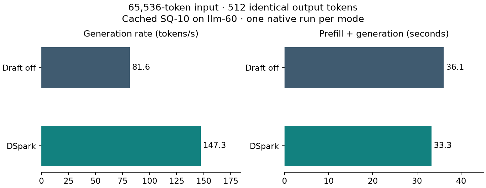

With a 4 GiB GPU expert pool, DSpark generated 512 tokens at 147.3 tokens/s. Drafting off produced the same IDs at 81.6 tokens/s. Each worker spent 29.8 seconds reading the register. Timings exclude model startup, HTTP and checkpoint publication. [Native timings and counters](docs/benchmarks/inkling/dspark-64k-generation.jsonl)

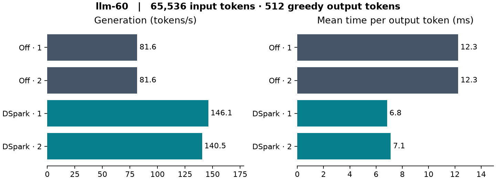

Two additional workers per mode reproduced all 512 output IDs. Before generation, all four agreed bit for bit on all 200,058 next-token scores. After generation the two undrafted workers still agreed exactly. The two DSpark workers chose the same next token but differed on every score, with a maximum absolute difference of 0.651. These timings and scores cover one prompt on llm-60. [Per-worker measurements](docs/benchmarks/inkling/dspark-64k-frontier-runs.jsonl) · [All pairwise score comparisons](docs/benchmarks/inkling/dspark-64k-frontiers.csv) · [Reproduce with the original token IDs](docs/benchmarks/inkling/frontier64/README.md)

At 131,072 input tokens on llm-60 with the same SQ-10 hybrid profile, two fresh workers read the register in 63.67 and 63.65 seconds. The undrafted worker generated 512 tokens in 7.56 seconds (67.8 tokens/s). DSpark generated the identical token IDs in 4.46 seconds (114.9 tokens/s). One run per mode, native timings after model load. All 200,058 scores matched after prefill. After generation, 200,056 scores differed bitwise with a maximum absolute difference of 0.689. Both workers still selected the same next token. [128k timings and counters](docs/benchmarks/inkling/dspark-128k-generation.jsonl) · [Full score comparisons](docs/benchmarks/inkling/dspark-128k-frontiers.csv)

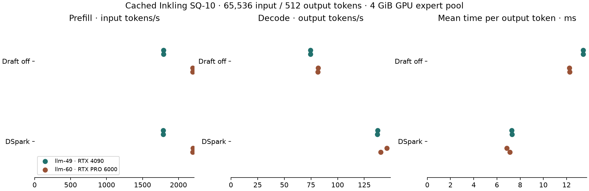

On llm-49 the matched SQ-10 RTX 4090 workers read 65,536 tokens in 36.57–36.64 seconds. Generation reached 74.5 tokens/s undrafted and 137.2–137.6 with DSpark. Each worker generated 512 tokens. [RTX 4090 timings](docs/benchmarks/inkling/llm49-64k-frontier-runs.jsonl) · [Within-host score comparisons](docs/benchmarks/inkling/llm49-64k-frontiers.csv)

Across the two GPU models, all 200,058 undrafted scores differed bitwise both immediately after prefill and after 512 output tokens. The highest-scoring token agreed at both positions, and both hosts generated the same 512 IDs. [Cross-host score comparison](docs/benchmarks/inkling/64k-cross-host-undrafted.csv)

### Reading a 250,000-token document on llm-60

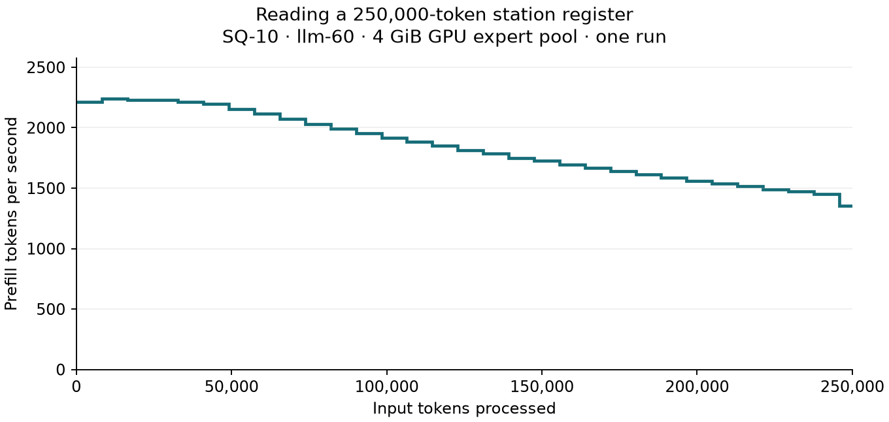

One SQ-10 worker processed 250,000 station-register tokens in **138.53 seconds** (1,805 input tokens/s). The native counter confirmed the full input length, and the backend returned 200,058 logits at the frontier. Timing starts after model load and tokenization. The run used a 262,144-token window, FP16 device KV, a 4 GiB GPU expert pool, forced GPU expert computation and drafting off. This prefill run measured input processing only. [Prefill timings](docs/benchmarks/inkling/llm60-250k-prefill.csv)

A separate native restart run saved an 8,363,606,016-byte parent and a 4,227,072-byte suffix for a two-token child. A fresh process imported both from disk and reproduced all 32 greedy continuation IDs and every full logit row after those steps. Its forward counter recorded exactly 32 tokens. This covers native checkpoint transfer. With batched follow-up prefill, across two processes, all three randomized lookups returned the expected visible label and identical generated token IDs. 0 of 3 child payload hashes matched. Each process imported the 250,064-token parent for its first question, then served two warm questions with zero checkpoint import bytes. [Six durable timings and hashes](docs/benchmarks/inkling/branchwrite-250k-lookup.csv) [Restart measurements and logit hashes](docs/benchmarks/inkling/llm60-250k-native-restart.json)

For repeated questions that need reproducible child checkpoints, pass `--serial-followup` to `tools/inkling_pcc_serve.py` with undrafted text. Root prefill stays batched. Each generation request consumes its appended text tokens individually. This setting has a distinct execution profile. On llm-60 with SQ-10, three randomized lookups produced identical output tokens and child payload hashes after restarting from one saved 250,064-token parent. The two warm requests after restart took 11.43 and 11.66 seconds. [Per-request measurements](docs/benchmarks/inkling/branchwrite-250k-serial.csv)

Enable `--suffix-checkpoints` for compact saves on the undrafted single-GPU text profile. On the tested second turn, Cached saved 14.34 MiB of changes plus a 0.76 MiB logit row. The cumulative checkpoint depends on the original full parent, which the disk cache retains while the checkpoint is needed. After restart, 12 continuation tokens and all final logits matched the full-checkpoint control. Use `--store DIRECTORY` for a persistent conversation store. [Second-turn measurements](docs/benchmarks/inkling/branchwrite-250k-cumulative-http.json)

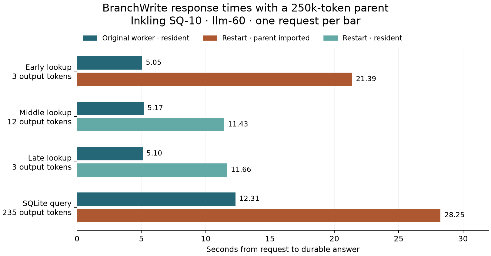

The register lookups and SQLite query used separate parents. Reading the document happened before timing began. Each bar covers one complete request, including child checkpoint publication. [SQL timings](docs/benchmarks/inkling/branchwrite-250k-sql.csv)

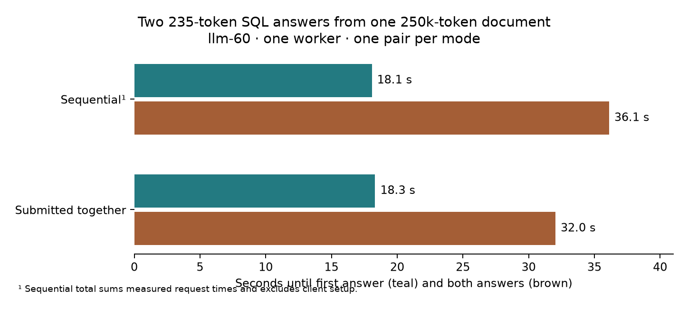

With one worker, two overlapping SQL requests finished in 32.04 seconds versus 36.12 seconds of summed sequential request time. All four generated 235 tokens, passed the SQL fixture, matched the checkpoint checksum and imported zero checkpoint bytes. Each mode used one pair of identical requests on separate branches. [Request timings](docs/benchmarks/inkling/branchwrite-250k-sql-pair.csv)

### Repeated questions on one 130K-token document

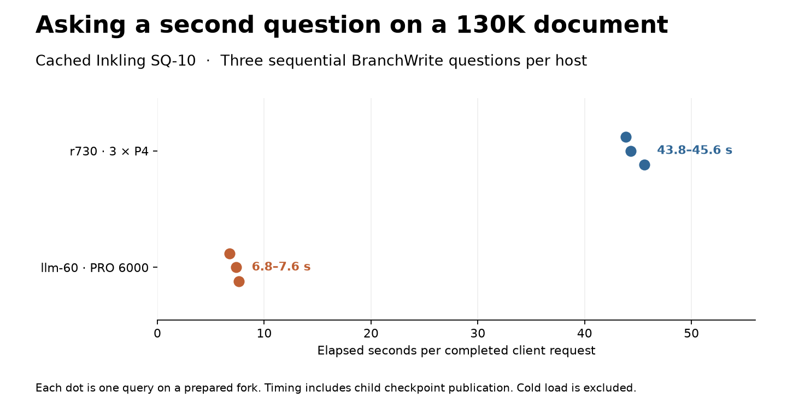

BranchWrite loaded the same register once per host and prepared three forks. Each dot measures one complete `ask` call, including its child checkpoint save. Preparing the forks and independently rereading the receipts happened outside the timer. On SQ-10, llm-60 answered the three questions in 21.74 seconds total. The worker spanning all three P4s took 133.76 seconds. All six requests reused the resident parent, retrieved the expected temperature, and appended units despite the number-only instruction. [Pooled P4 results](docs/benchmarks/inkling/warm-130k-combined-sequential.csv) · [llm-60 results](docs/benchmarks/inkling/warm-130k-llm60-traced-sequential.csv)

### Tesla P4 independent streams and layer splitting

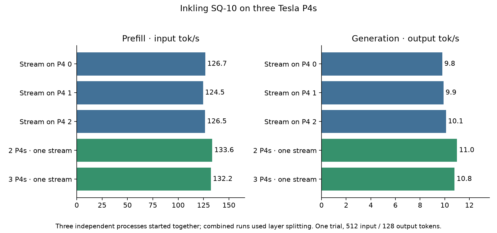

Each process used SQ-10, greedy native decoding, FP16 device KV and drafting off. The three one-card workers started concurrently. Each combined run served a single stream and placed every expert on the selected GPUs. Each bar represents one 512-token prompt and 128 generated tokens. [Download the rates](docs/benchmarks/inkling/p4-topology.csv) and [see the separate 64K capacity check](docs/benchmarks/inkling/p4-capacity.csv).

At 64K, three SQ-10 workers with all experts in host RAM decoded 32 steps each after a synchronized start from synthetic 65,504-token FP16 KV states. Across the common wall-clock interval the three cards produced **15.21 output tok/s combined**. The interval includes native decode, finite-logit checks and greedy selection. Real prompt prefill is outside this measurement. [Per-stream timing](docs/benchmarks/inkling/p4-64k-decode.csv)

Giving each worker a 1 GiB GPU expert budget raised synchronized throughput to **18.85 output tok/s combined** over 32 steps per card. Each worker kept 374 experts in VRAM and 2,698 in host RAM. The chart shows one trial per configuration. The all-host free-memory readings come from the separate capacity check at the final position. [1 GiB per-worker results](docs/benchmarks/inkling/p4-64k-expert-budget.csv)

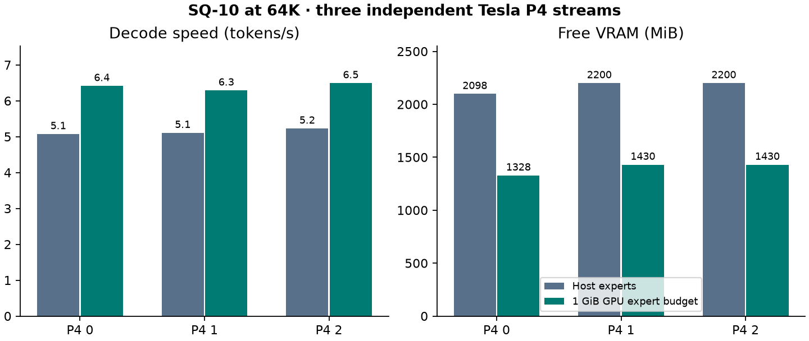

With a zero GPU expert budget, three independent P4s each read 65,504 real
prompt tokens and answered the final-station question correctly. Their 32
synchronized decode steps delivered 16.36 tok/s combined with 2,098–2,200 MiB
free per card, compared with 16.49 tok/s and 1,584–1,686 MiB at a 768 MiB
expert budget. Each placement was tested once. A single-P4 synthetic FP16 KV
test reached 111,360 slots with finite final logits. The runtime capped requests
for 114,688 and 131,072 slots at 111,360 on GPU 0 in this configuration.
[Real-prompt timings](docs/benchmarks/inkling/p4-allhost-real-64k.csv) ·
[Single-P4 capacity probes](docs/benchmarks/inkling/p4-allhost-edge.csv)

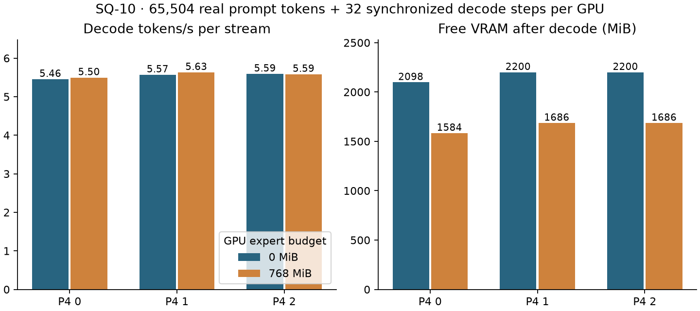

During concurrent prefill of a real 65,504-token register with the GPU expert
budget set to zero, the three P4 processes accounted for 24.64 GiB of host
RAM combined by proportional set size (PSS). Each worker had its own roughly
8 GiB mapping with a distinct inode and zero proportional swap. The earlier
768 MiB GPU-budget trial sampled 24.64 GiB combined. These snapshots cover
the worker processes during prefill and exclude other host allocations.
[Zero-budget process mappings](docs/benchmarks/inkling/p4-allhost-prefill-pss.csv)
· [768 MiB budget comparison](docs/benchmarks/inkling/p4-prefill-host-memory.csv)

A single Cached HTTP worker reading a 65,000-token document on SQ-10 with a 768 MiB GPU expert budget had 1,953 MiB free at 57,344 allocated KV slots and 1,697 MiB free at 65,536 slots. These are device-wide prefill samples from P4 index 2 on r730. [VRAM samples](docs/benchmarks/inkling/p4-prefill-vram-by-capacity.csv)

Cached loaded a 65,000-token register through BranchWrite HTTP in 17m 55s on a single P4. The first question took 48.9s. After restarting the server, repeating it took 58.2s and imported 2.30 GB from tmpfs. A different question then took 43.4s and imported zero bytes. Both answers were correct, and each request forwarded 18 tokens. These measurements include checkpoint handling. [Per-request results](docs/benchmarks/inkling/p4-shared-document.csv)

Three independent P4 workers also read the same 65,504-token register from scratch, using a 0.75 GiB expert budget on each card. Each produced the correct final-station temperature before the first message boundary. Reading took 17.9–18.8 minutes per worker. The native benchmark continued for 32 fixed greedy steps. The workers finished prefill at different times, so their individual decode rates cannot be added to infer simultaneous decode throughput.

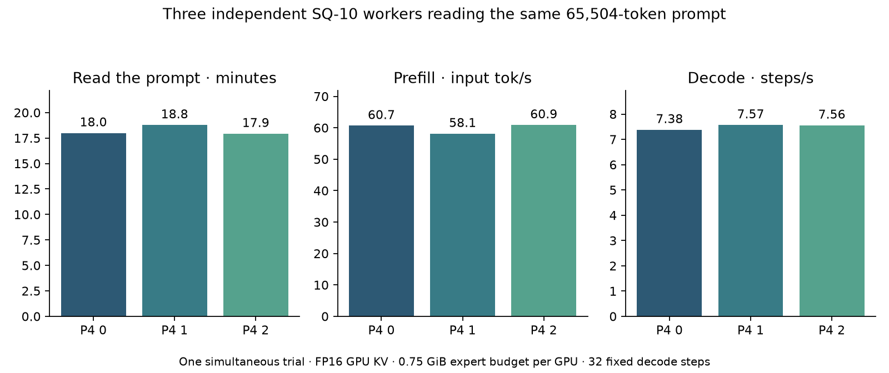

[Download the per-worker results](docs/benchmarks/inkling/p4-register.csv)

At 1 GiB of GPU experts per card, all three P4 workers again answered the final-station question correctly. Each read 65,504 tokens in 17.9–18.6 minutes and decoded 32 steps at 7.34–7.68 tok/s. With one run per placement and card, the timings are close to the 768 MiB results. The larger placement used another 256 MiB per card. [Per-worker comparison](docs/benchmarks/inkling/p4-register-placement.csv)

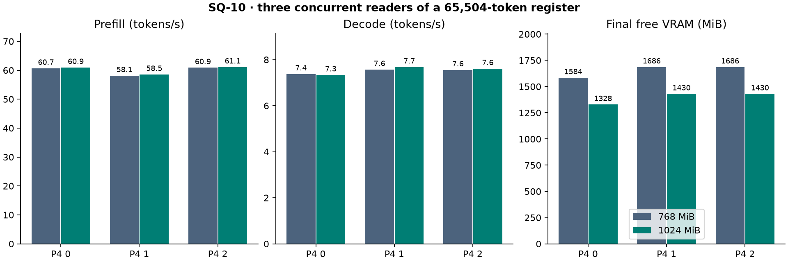

For a single Cached worker split across three P4s, apply the [layer-split checkpoint patch](experimental/branching_context/native/inkling/layer-split-checkpoint.patch) after the portable-state and DSpark patches, then rebuild the bridge. Launch with `CUDA_VISIBLE_DEVICES=0,1,2 python tools/inkling_pcc_serve.py RUNTIME --gpus 3 --pack SQ-10`. This places each layer and its KV on its owning GPU. The three-card HTTP restart test covers a short greedy text request. The native restore test covers a 2,049-token prefix.

For single-GPU host KV, apply the [host-KV checkpoint patch](experimental/branching_context/native/inkling/host-kv-checkpoint.patch) after the layer-split patch and rebuild the CUDA backend and bridge. The PCC launcher accepts `--kv-offload on` for host-backed global KV and `--kv-offload auto` to split global KV when the requested capacity exceeds the GPU budget. The default is `off`. The selected mode is part of the checkpoint execution identity. With SQ-10 on a Tesla P4, the 8,192-capacity host-backed HTTP profile reproduced a short chat after a server restart. [Qualification results](docs/benchmarks/inkling/qualification.md)

BranchWrite also restored the 65,000-token register on the three-card worker. Loading the parent took 16m 57s. After restart the first lookup imported 2,302,705,664 bytes from tmpfs and reproduced the original tokens. The next question reused the resident parent, imported zero bytes and answered correctly. Each lookup forwarded 18 tokens. The chart shows one run per configuration, including checkpoint handling. [Per-operation timings and counters](docs/benchmarks/inkling/p4-shared-document-topology.csv)

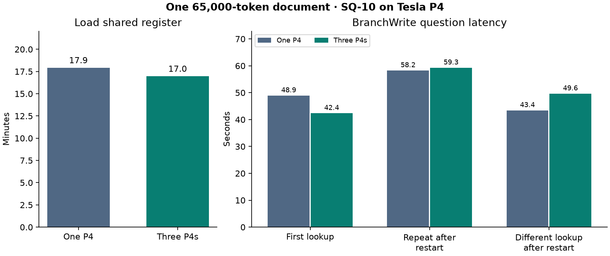

On one P4, each warm branch returned all 40 station labels from a 65,035-token resident prompt. Portable checkpoint capture took 0.08 seconds per branch. The two complete requests took 54.17 and 56.30 seconds, including about 13 seconds each to save state. [Per-request timings](docs/benchmarks/inkling/p4-65k-portable-save-http.csv)

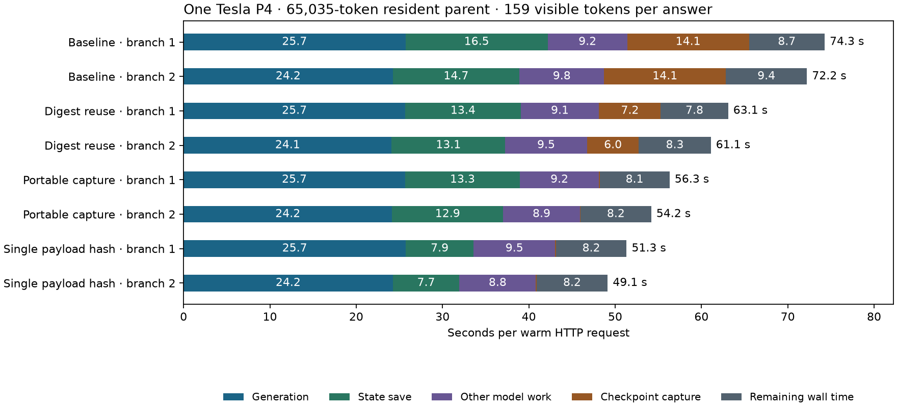

With one 65,035-token parent resident on each P4, three simultaneous HTTP requests delivered 7.52 and 7.90 visible tokens/s combined in two trials. First visible text arrived in 9.79–10.72 seconds. All six responses returned all 40 labels in order with zero checkpoint-import bytes. Five-second sampling from late prefill through the warm requests found a minimum of 1,585 MiB free on GPU 0 and 1,687 MiB on GPUs 1 and 2. [Memory samples by card](docs/benchmarks/inkling/p4-three-http-vram.csv) · [Individual timings](docs/benchmarks/inkling/p4-three-warm-http.csv)

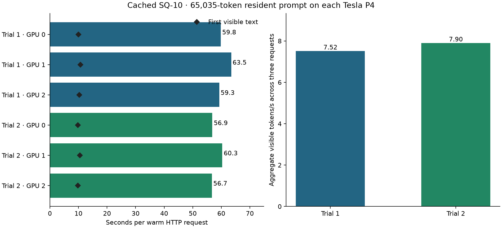

Once text started streaming, the mean time per visible output token ranged from 149 to 189 ms across the six requests. Each mean uses the first-to-last text interval divided by 158, for 159 visible tokens.

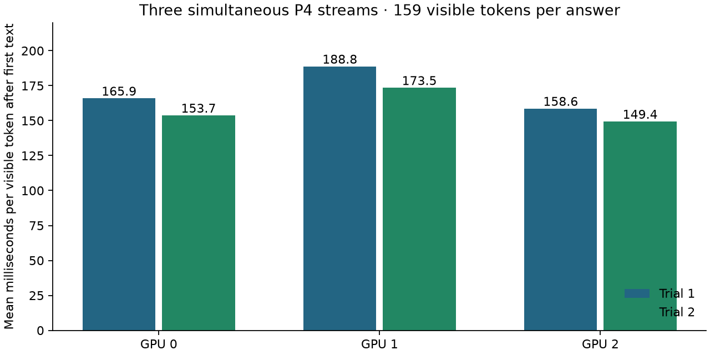

### RTX 4090 and RTX PRO 6000 Blackwell


Each bar averages two single-request transcription trials with a fresh branch, 1,024 greedy output tokens, SQ-20 weights, FP16 KV, an 8,192-token capacity, 512-token prefill chunks and a 5 GiB RAM checkpoint pool. Both hosts kept all 3,072 experts on the GPU. Each drafting mode started a fresh server. The native prefill timer covers the 3,045 or 6,045 tokens consumed during branch creation. The client timer starts before branch creation and ends after the streamed completion receipt. Existing services also held VRAM on the RTX PRO 6000. These are single-request measurements on the two hosts.

[Download individual timings and generated-token hashes](docs/benchmarks/inkling/gpu-comparison.csv)

### 64K and 128K single requests

Each bar measures one cold request on one RTX PRO 6000 Blackwell, with SQ-20 weights, FP16 KV, a 512-token prefill chunk and a 1,024-token output. Each configuration starts a fresh server. Time to first visible token includes prompt processing. Peak GPU memory is sampled across the serving process and its children. The Cached client also times root creation and branch completion in the complete operation. All eight runs returned the same output text. Repeated questions on a shared parent require a separate warm-cache measurement.

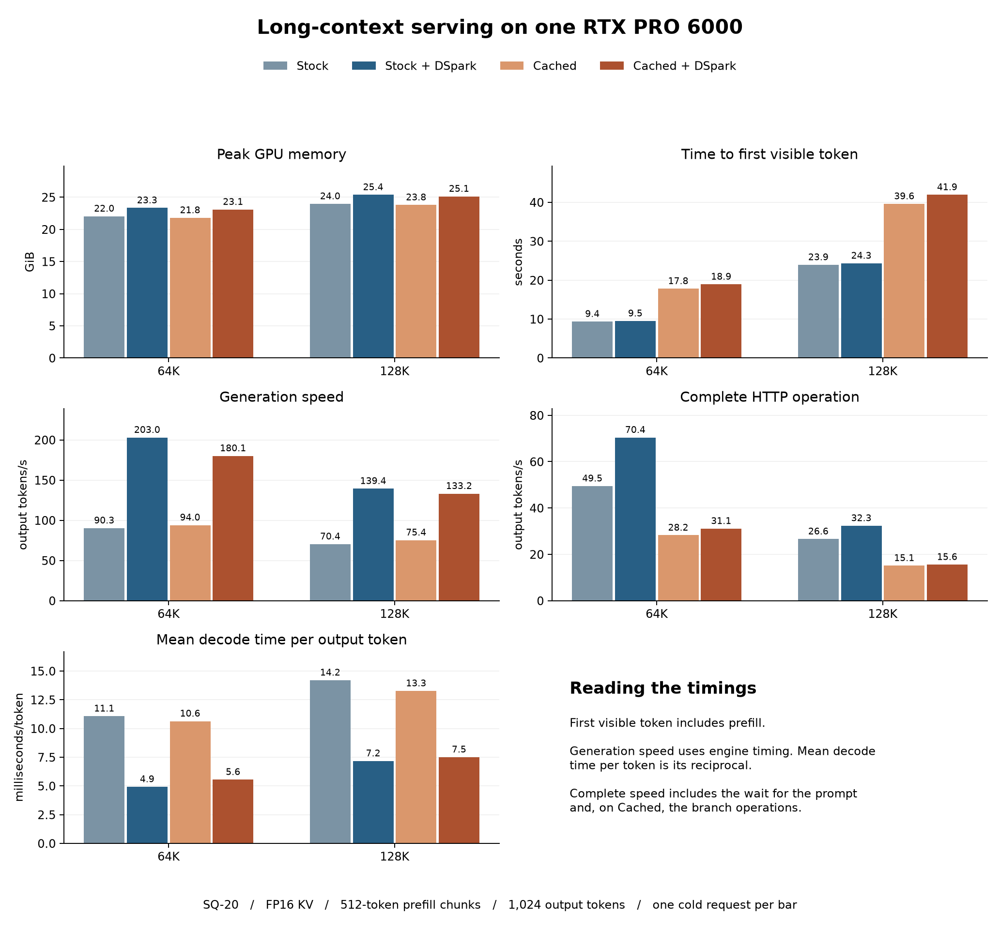

[Download the underlying long-context measurements](docs/benchmarks/inkling/long-context.csv)

The client also timestamped first text, last text and the complete receipt. At 128K with DSpark the last text arrived 16.3 seconds before the receipt. The server separately measured 3.8 seconds inside its capture timer. A separate instrumented repeat measured 16.2 seconds from last text to receipt. Three successive server operations accounted for 14.3 seconds of that interval: checkpoint export (6.80 s), checkpoint preparation (3.76 s), and publication to the temporary RAM-backed filesystem (3.75 s). The 4.94 s native export is included in the export total. The 1.48 s payload write is included in publication. The parent restore counter showed zero imported bytes. After removing a full host-side payload copy, one matched repeat reduced native child export from 4.94 to 1.77 seconds and last-text-to-receipt time from 16.23 to 12.91 seconds. Both runs returned the same text.

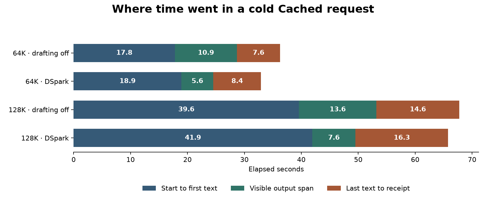

[Download the phase and capture timings](docs/benchmarks/inkling/cached-request-phases.csv)

Stock Strata reported prompt processing speed and the number of DSpark draft tokens offered and accepted. Cached repeated the same workload after accepted-node accounting was added. Both engines produced identical output text at each length.


[Download the prefill and proposal counts](docs/benchmarks/inkling/stock-dspark.csv)


[Download the cross-engine proposal counts](docs/benchmarks/inkling/dspark-acceptance.csv)

### Matched drafting throughput

On a synthetic administration log, native fused DSpark averaged 148.2 tokens/s (6.7 ms per output token). All four modes produced the same 259 token IDs. The chart pools decode time across the runs shown for each mode, including four plain SQ-10 controls. It excludes startup and prefill. Per-token streaming latency was not instrumented.

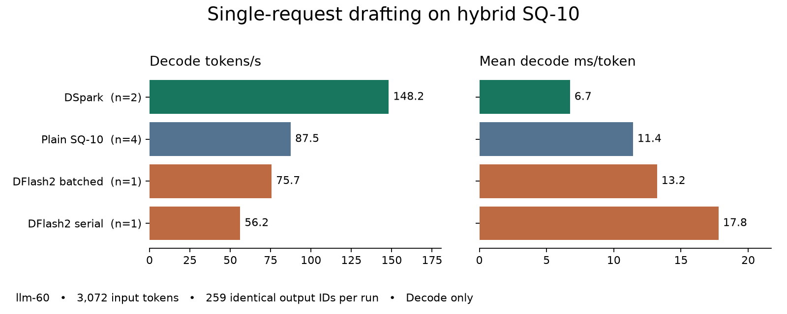

[DSpark trials](docs/benchmarks/inkling/dspark-hybrid-control.csv) · [Batched DFlash2 trial](docs/benchmarks/inkling/dflash2-batch-control.csv) · [Serial DFlash2 trial](docs/benchmarks/inkling/dflash2-3072-greedy-control.csv)

The DFlash2 prototype ran live with hybrid SQ-10 and serial target verification on llm-60. Keeping the output head on the GPU reduced median proposal time across all three prompts. [Per-block timings](docs/benchmarks/inkling/dflash2-head-placement.csv)

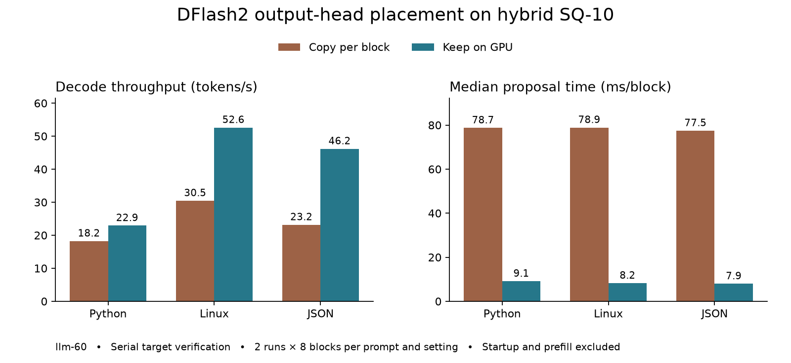


### DFlash2 verifier timing

On llm-60, direct retention of the batched prefix missed full-logit exactness on both tested prompts. Rewinding and replaying the accepted prefix sequentially recovered the control frontier. In six warm trials per prompt, the extra verification work cost about 13.5 ms per block before draft generation.

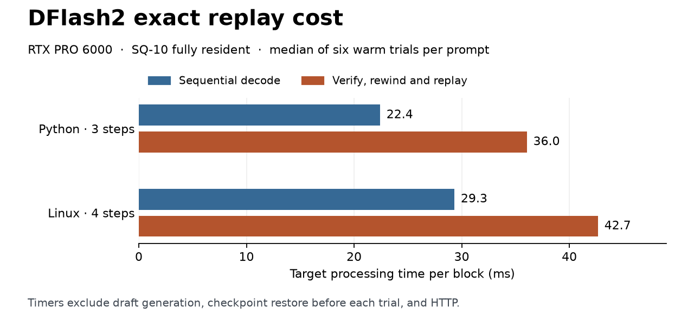

[Download all paired timings, including warmup](docs/benchmarks/inkling/dflash2-replay-cost.csv)

### Three questions on one 128K document

BranchWrite loaded one station register, forked three siblings from the same parent and asked each a different lookup question. All three asks restored the resident parent and imported zero checkpoint bytes. Two answers were correct. The bars time parent loading and each ask through answer and receipt verification. Fork creation is outside the ask timer. Each bar is one observation.


[Download the shared-parent measurements](docs/benchmarks/inkling/resident-128k.csv)

An offline delta-storage experiment used the saved checkpoints from these same three children. Each 4.47 GB child reconstructed from the parent plus a 12.41 MB rsync delta, with its full SHA-256 verified. Applying each delta to a parent copy in RAM took 5.58–5.76 seconds, excluding the initial parent copy and final hash check. The live server still exports full child payloads.


[Download the cumulative payload sizes](docs/benchmarks/inkling/shared-parent-storage.csv)

### 3K and 6K single requests

One NVIDIA RTX PRO 6000 Blackwell, SQ-20 weights resident on the GPU, FP16 KV.
Each short-context HTTP throughput bar summarizes four single-request transcription trials
with 1,024 output tokens. The complete Cached request includes root creation
and the branch receipt. The generation panel uses each engine’s reported
generation time. Stock used a 2,048-token prefill chunk and Cached used 512.

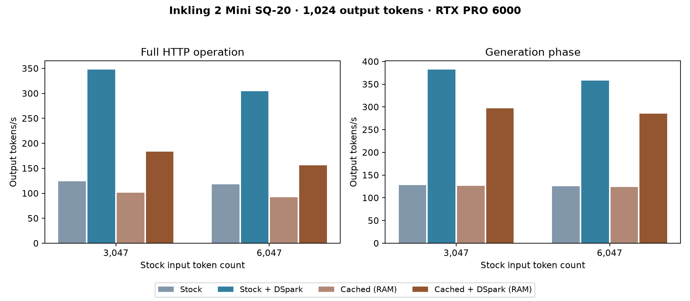

The latency chart shows each observed request, the median and an interpolated p95. Its TPOT measure is engine generation time divided by 1,024 output tokens. Each group contains four trials, including the first. With four observations, the p95 is descriptive only and gives little evidence about production tail latency. Each of the 32 transcription requests produced 1,024 visible tokens and zero reasoning tokens. For Cached, decoding every recorded token ID reproduced the returned text byte for byte and no channel markers occurred. Stock reported zero reasoning tokens in its usage counters. [Per-request token counts](docs/benchmarks/inkling/output-channels.csv)


[Download the latency summaries](docs/benchmarks/inkling/http-latencies.csv)

The following memory measurements sample the serving process and its children
during one request per configuration. Host checkpoint RAM is excluded.


### Fresh-process checkpoint restore

Four fresh engine processes restored the same 4,097-token checkpoint with the OS filesystem cache retained. Median restore time was 475 ms. Reading the next-token frontier afterward took a median 155 ms. All 200,058 FP32 logits matched the saved reference byte for byte on every trial, with zero forward tokens. Timers exclude model loading. This measurement used SQ-20, FP16 KV and drafting off.

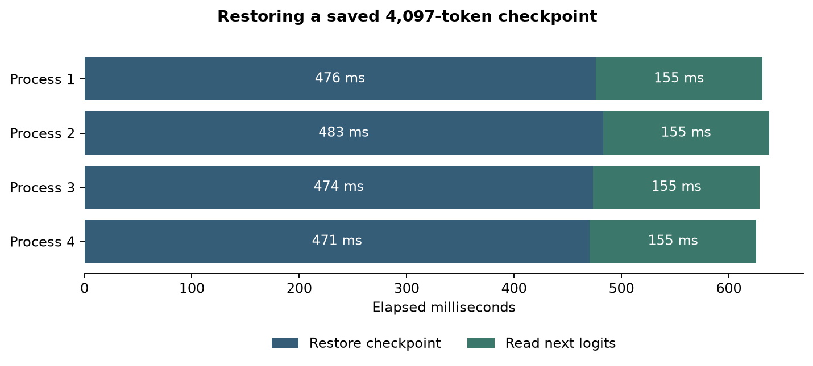

[Download the four restore trials](docs/benchmarks/inkling/checkpoint-restore.csv)

### Concurrent requests

The native concurrency sweep used independent 4,097-token prompts and 256
output tokens per slot. A repeat at 38, 54, 56 and 64 slots found 1,093.2 aggregate tokens/s at 64 slots, compared with 643.5 on its first run. Both runs fit in GPU memory. The first sweep’s drop above 54 slots did not reproduce. The original 38-slot memory sample was below the model footprint and is omitted. Its repeat measured 35.44 GiB.

[Download both concurrency runs](docs/benchmarks/inkling/native-concurrency.csv)


### Independent 128K contexts

Eight native slots each processed 131,072 prompt tokens and generated 256 output tokens. All 3,072 experts were GPU-resident with FP16 KV, KV offload disabled and drafting off. At eight slots, aggregate decode reached 196.5 tokens/s and sampled process memory peaked at 55.4 GiB. Each point is one run. The benchmark allocates an independent context per slot.

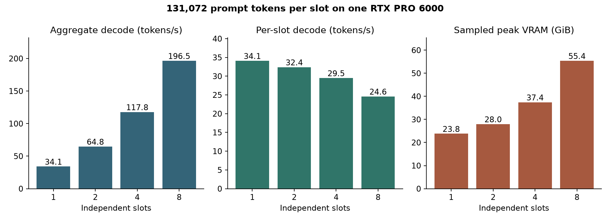

[Download the 128K concurrency measurements](docs/benchmarks/inkling/native-128k-concurrency.csv)

A separate startup probe requested 131,328 tokens per independent slot from 8 through 54 slots. The chart shows the engine’s effective capacity after automatic sizing. Shorter capacities are startup observations. Generation was verified at the full requested length through eight slots. The CSV records GPU memory available before each load.

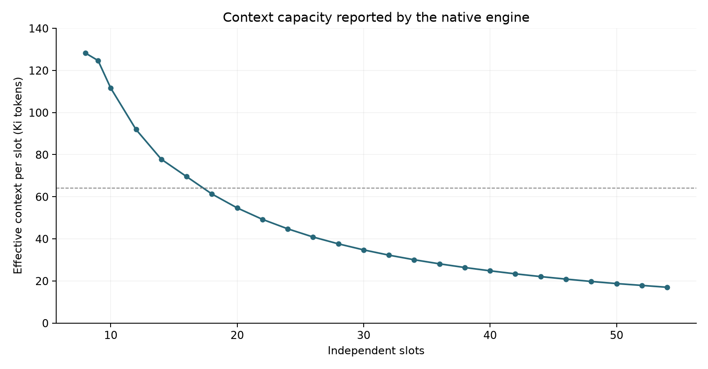

[Download the context capacity sweep](docs/benchmarks/inkling/native-context-capacity.csv)

### Training on the latest mistakes

A rank-4 AdamW output-head adapter trained for eight steps on three missed lookups, then took one step per round on the previous round’s misses. Each checkpoint answered all 54 questions against the same 128K document. Step 8 fixed two original misses and lost 39 previously correct answers. Step 11 recovered all 51 original successes and fixed two misses, reaching 53/54. On a fresh 24-question register the base scored 22 and the step-11 adapter scored 21. The base remains the serving default.

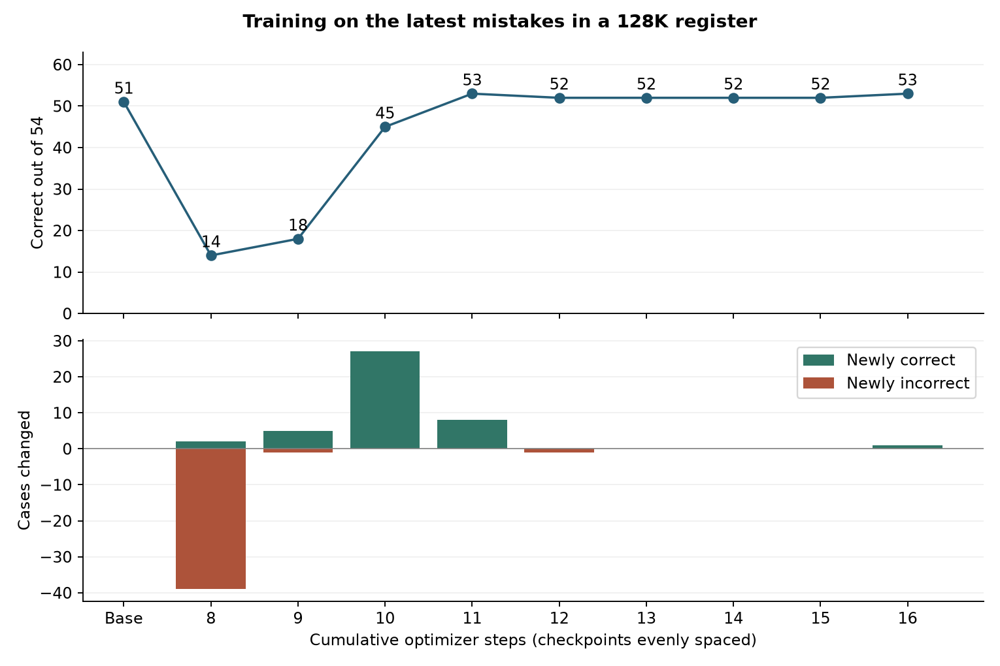

[Download the aggregate training and retention counts](docs/benchmarks/inkling/training-retention.csv)

In a separate experiment, each optimizer trained only on the original three corrections. On the first round, Muon fixed all three but retained only 5 of the 51 original successes. AdamW fixed two and retained 12. [Paired first-round counts](docs/benchmarks/inkling/station-first-round-paired.csv). The second Muon round stayed at 8/54 while fixing six previously wrong answers and losing six previously correct ones. Starting from the first AdamW adapter, adding a second rank-4 update produced a rank-8 sum that scored 15/54. Compressing that sum to rank 4 changed eleven answer texts and lost one correct answer, leaving 14/54.

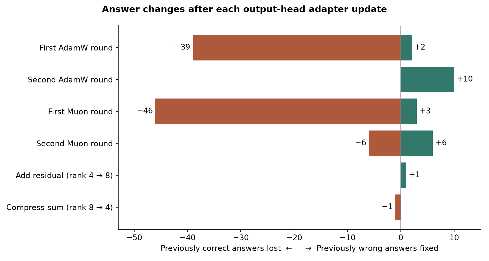

[Download the paired adapter comparisons](docs/benchmarks/inkling/adapter-transitions.csv)

## Native inference baseline

Use the Linux x86-64 CUDA 13 `strata-inkling` 0.1.69 package from
[Strata 0.2.22](https://github.com/Niko1221/Strata/releases/tag/v0.2.22) and
`Inkling-2-Mini-SQ-20.strata` from the
[pinned checkpoint revision](https://huggingface.co/strata-engine/Inkling-2-Mini-Strata/tree/04996a1e2c45009b6a04f2af126cb6bdb2ba3587).
Extract the engine archive and place the checkpoint beside the executable. The
checkpoint uses about 18 GiB. On llm-60 both belong under
`/mnt/fast_cache/inkling`.

```bash
INKLING_DIR=/mnt/fast_cache/inkling tools/inkling_smoke.sh
```

The baseline uses FP16 conversation state and disables speculative decoding.

For a single-request HTTP endpoint, also place the pinned Strata checkout at
`strata-source` and the companion tokenizer files from the checkpoint revision
under `tokenizer`. Install `tokenizers`, `jinja2` and `regex` into the runtime environment.

```bash
python tools/inkling_serve.py /mnt/fast_cache/inkling
curl --fail-with-body http://127.0.0.1:18060/v1/chat/completions \
    -H 'Content-Type: application/json' \
    -d '{"model":"Inkling-2-Mini","messages":[{"role":"user","content":"What is 2 + 2? Reply with just the number."}],"max_tokens":128,"temperature":0}'
```

The HTTP endpoint binds to loopback and serves one request at a time.
For image input, install Pillow and put `Inkling-2-Mini-Vision.strata` from
the same pinned checkpoint revision next to SQ-20. Then run:

```bash
python tools/inkling_serve.py /mnt/fast_cache/inkling --vision
# From a second shell on the GPU host, once the service reports ready:
python tools/test_inkling_http.py
```

The test sends the same question with two different PNGs, verifies the
answers, checks text inference after an invalid model request, and verifies
that disconnecting a stream cancels generation and releases the slot.

## Building the native engine

Build the pinned Strata source with CMake and a CUDA toolkit that supports
SM120. On llm-60 the build uses CUDA 13.5 and writes to the fast-cache
runtime directory beside the released executable.

```bash
git -C /mnt/fast_cache/inkling/strata-source sparse-checkout add engine
tools/inkling_build_native.sh /mnt/fast_cache/inkling
/mnt/fast_cache/inkling/native-build/strata-inkling --version
```

`INKLING_NVCC`, `INKLING_CUDA_ARCHS` and `INKLING_BUILD_JOBS` can override the
compiler path, GPU architecture and build parallelism.

## PCC integration

PCC's Inkling CUDA adapter stores per-visit full-attention and sliding-window
KV, ShortConv state, and a separately stored full-vocabulary frontier. The
pinned profile consumes canonical text token IDs at 8K context with FP16 KV,
512-token prefill chunks, and drafting disabled. The HTTP service defaults to an 8 GiB resident checkpoint budget at 8K context and scales it up for longer contexts. Use `--ram-cache-gib N` to set the budget explicitly. The worker cache also has a 32-entry limit. Disk checkpoints use PCC's existing
checksummed envelope and bind the model, tokenizer, execution profile and
token history. An optional vision profile uses the pinned vision tower and
absolute-position image embedding rows. Its histories also bind the original
image, encoder profile, and exact embedding bytes. The Strata chat baseline
and the PCC token service have separate launchers.

The [upstream README](README-PCC.md) records earlier PCC model results. Those
results apply to their documented profiles.

## Serving performance

Establish a cold and warm single-request baseline on llm-60 before tuning.
Measure prefill rate, time to first visible token, decode rate, peak VRAM and
restore latency across short and long prompts. Track visible and reasoning
tokens separately.

Use exact FP16-state continuation as the reference for RAM and disk cache
tests. Then measure native FP4 kernels and DSpark drafting with the same
weights, prompts, decoding settings and context sizes. Explore selective
layer and expert residency when the full checkpoint exceeds available VRAM.
Compare concurrent requests after the single-request results are reproducible.

### Native checkpoint regression

Apply [the CUDA state patch](experimental/branching_context/native/inkling/portable-state.patch)
to the pinned Strata checkout. Build the standalone regression with
`-DINKLING_PORTABLE_STATE_TEST_SOURCE=/absolute/path/to/check_portable_state.cpp`
in the native CMake build directory. Then run:

```bash
cmake --build native-build --target inkling_portable_state_test
native-build/inkling_portable_state_test Inkling-2-Mini-SQ-20.strata write portable-test.bin
native-build/inkling_portable_state_test Inkling-2-Mini-SQ-20.strata read portable-test.bin
```

For a three-P4 layer split, build with the layer-split checkpoint patch, select the SQ-10 model, and add `--three-gpu` to both the write and read commands. Use a path on tmpfs for the fixture to avoid disk writes.

On llm-60 the 4,097-token fixture exported 305,856,512 bytes of native state.
RAM restore after a sibling write and disk restore in a fresh process
matched all 200,058 continuation logits bit for bit with CUDA, FP16 KV,
8K context, 512-token prefill chunks and DSpark disabled. The native-only fixture stores unframed test bytes. The PCC regression below
uses the durable checkpoint format.

### PCC CUDA checkpoint regression

For a clean build on an RTX PRO 6000 Blackwell, run these commands from the Cached checkout. Set `assets` to the directory containing the SQ-20 model and the original pinned Hugging Face tokenizer saved as `tokenizer-source.json`. The commands create a new runtime and build directory, apply the checkpoint patches in order and exercise restore in a second Python process.

```bash
set -e
assets=/mnt/fast_cache/inkling
runtime=$(mktemp -d "$assets/inkling-clean.XXXXXXXX")
bridge="$PWD/experimental/branching_context/native/inkling"
git init -q "$runtime/strata-source"
git -C "$runtime/strata-source" remote add origin https://github.com/Niko1221/Strata
git -C "$runtime/strata-source" fetch --depth=1 origin b28ca95e3e6847f2d5e317994f253b66716deeaa
git -C "$runtime/strata-source" checkout --detach FETCH_HEAD
for patch in portable-state dspark-checkpoint layer-split-checkpoint; do
    git -C "$runtime/strata-source" apply "$bridge/$patch.patch"
done
ln -s "$assets/Inkling-2-Mini-SQ-20.strata" "$runtime/"
ln -s "$assets/tokenizer-source.json" "$runtime/"
cmake -S "$runtime/strata-source/engine/src/inkling2" -B "$runtime/native-build" \
    -DCMAKE_BUILD_TYPE=Release -DSTRATA_ENABLE_CUDA=ON -DSTRATA_INK_CUDA_ARCHS=120 \
    -DCMAKE_CUDA_COMPILER=/usr/local/cuda/bin/nvcc -DCMAKE_POSITION_INDEPENDENT_CODE=ON \
    -DINKLING_PCC_BRIDGE_SOURCE="$bridge/inkling_bridge.cpp"
cmake --build "$runtime/native-build" --target inkling_pcc_bridge --parallel 6
python3 -m venv "$runtime/.venv"
export PYTHONPATH="$PWD/experimental/branching_context/src"
export LD_LIBRARY_PATH="/usr/local/cuda/lib64${LD_LIBRARY_PATH:+:$LD_LIBRARY_PATH}"
test_dir=$(mktemp -d /dev/shm/inkling-check.XXXXXXXX)
"$runtime/.venv/bin/python" tools/test_inkling_pcc.py "$runtime" "$test_dir" write
"$runtime/.venv/bin/python" tools/test_inkling_pcc.py "$runtime" "$test_dir" read
```

#### Native parent-plus-suffix regression

For the experimental single-GPU FP16 KV exporter, start from the patched Strata checkout and build variables above. Use a dedicated build directory because the suffix patch extends the native backend interface. The fixture uses SQ-10, a 3 GiB GPU expert budget, and two processes on the same GPU. Set `weights` to the SQ-10 pack path.

```bash
git -C "$runtime/strata-source" apply "$bridge/parent-suffix.patch"
suffix_build="$runtime/suffix-build"
engine="$runtime/strata-source/engine"
cmake -S "$engine/src/inkling2" -B "$suffix_build" \
    -DCMAKE_BUILD_TYPE=Release -DSTRATA_ENABLE_CUDA=ON -DSTRATA_INK_CUDA_ARCHS=120 \
    -DCMAKE_CUDA_COMPILER=/usr/local/cuda/bin/nvcc -DCMAKE_POSITION_INDEPENDENT_CODE=ON \
    -DINKLING_PCC_BRIDGE_SOURCE="$bridge/inkling_bridge.cpp"
cmake --build "$suffix_build" --target inkling_pcc_bridge --parallel 6
c++ -std=c++20 -O2 -DINKLING_ENABLE_CUDA -I"$engine/src/inkling2" -I"$engine/include" \
    "$bridge/check_parent_suffix.cpp" -L"$suffix_build" -Wl,-rpath,"$suffix_build" \
    -linkling_pcc_bridge -o "$suffix_build/check_parent_suffix"
fixture=$(mktemp /dev/shm/inkling-suffix.XXXXXXXX)
for phase in write read; do
    STRATA_INK_EXACT=1 "$suffix_build/check_parent_suffix" "${weights:?Set the SQ-10 pack path}" "$phase" "$fixture"
done
unlink "$fixture"
```

On llm-60 the writer extended a 1,017-token parent by 18 tokens across the sliding-window boundary. The 7,372,800-byte suffix and parent reproduced the full 205,520,896-byte native child image. The reader loaded the fixture in a fresh process and matched all 200,058 uninterrupted continuation logits. To exercise complete replacement of the sliding window, append `--wrapped` to both the write and read invocations. This fixture extends a 1,537-token parent by 1,027 tokens. The HTTP server still uses full checkpoints.

To reproduce the 128K Python backend measurement on llm-60, use the suffix-enabled build from above. Set `weights` to an absolute SQ-10 pack path. The temporary runtime links to the existing assets. Its parent checkpoint stays in RAM.

```bash
suffix_runtime=$(mktemp -d "$assets/suffix-runtime.XXXXXXXX")
ln -s "$suffix_build" "$suffix_runtime/native-build"
ln -s "$weights" "$suffix_runtime/Inkling-2-Mini-SQ-10.strata"
ln -s "$assets/tokenizer-source.json" "$suffix_runtime/tokenizer-source.json"
PYTHONPATH="$PWD/experimental/branching_context/src" INKLING_EXPERT_VRAM_MIB=4096 STRATA_INK_EXACT=1 \
    "$runtime/.venv/bin/python" tools/test_inkling_pinned_suffix.py "$suffix_runtime" --parent-tokens 131072
```

The regression reports parent selection, suffix export and suffix import times separately. It checks the full continuation logits for three sibling switches and counts transferred bytes and forwarded tokens. [Measured timings](docs/benchmarks/inkling/suffix-128k-phases.csv)

The clean-checkout run at `0e77805` reused the host CUDA installation and model assets. Its fresh process restored the checkpoint in 0.518 seconds. The temporary test store is RAM-backed and can be removed after checking the results.

The two-process regression passed on llm-60 with the pinned Strata source
`b28ca95e3e6847f2d5e317994f253b66716deeaa` and CUDA 13.5. RAM and disk
restore matched all 200,058 frontier logits and all 200,058 logits after one
continuation token. Restore consumed zero prefix tokens. A sibling write
preserved the parent. The test rejected changed model, execution and input
identities with valid manifest checksums, and rejected a flipped payload byte.
The 306,656,744-byte disk payload restored in 0.530 seconds in that run.
PCC's G0 reference suite passed 58 tests. Coverage here is the single-GPU,
text-token, draft-off profile with owned copies of the native state.

For the image-aware profile, place the pinned vision tower alongside the
text checkpoint and run the vision regression in a separate workspace:

```bash
test_dir=$(mktemp -d "$runtime/pcc-vision.XXXXXXXX")
python tools/test_inkling_pcc_vision.py "$runtime" "$test_dir" write
python tools/test_inkling_pcc_vision.py "$runtime" "$test_dir" read
```

On llm-60, the two images used identical text and placeholder token IDs and
produced distinct history IDs and frontier logits. Each image matched all
200,058 frontier and continuation logits through RAM restore after sibling
writes and disk restore in a fresh process. The native work counter recorded
zero replay. The fresh-process test had no image encoding step.

### PCC HTTP token and chat service

After building the PCC bridge, start the authenticated localhost service
with a private, temporary store under Linux `/dev/shm`:

```bash
python tools/inkling_pcc_serve.py /mnt/fast_cache/inkling
```

Use `--pack SQ-10`, `--pack SQ-15`, or the default `--pack SQ-20` to select a fingerprinted checkpoint in the runtime directory. Each pack has its own model contract and default persistent store. On the r730, `CUDA_VISIBLE_DEVICES=2 STRATA_INK_EXACT=1` with SQ-10 reproduced a short chat after a process restart with FP16 KV and hybrid expert placement.

For a single Cached worker spanning two P4s, rebuild the native bridge and run:

```sh
CUDA_VISIBLE_DEVICES=0,1 STRATA_INK_EXACT=1 python tools/inkling_pcc_serve.py RUNTIME --pack SQ-10 --gpus 2
```

At the default 8,192-token capacity, the r730 placed 1,320 experts on the first card and 1,752 on the second. The restarted HTTP worker reproduced the four generated token IDs and checkpoint SHA-256. The native counter recorded six forward tokens, including two chat framing tokens. The KV state resides on the primary card. This test used greedy chat with drafting off.

For a single P4 with a 65,536-token capacity, the following configuration gives the GPU expert pool 768 MiB. The remaining experts live in host RAM. The budget is part of the execution profile. Rebuild the native bridge when upgrading to this option.

```bash
CUDA_VISIBLE_DEVICES=1 STRATA_INK_EXACT=1 INKLING_EXPERT_VRAM_MIB=768 python tools/inkling_pcc_serve.py RUNTIME --pack SQ-10 --capacity 65536
```

The temporary store holds checkpoint files and branch metadata in tmpfs and is removed on normal shutdown. This still uses RAM for serialized checkpoints in addition to resident cache entries. For restart and disk durability testing, pass `--persistent` to reuse the profile’s runtime directory or `--store PATH` to select a directory. Use the same option on both launches.

The launcher creates a private `pcc-http.key` in the runtime directory.
The service listens on port 18061 by default. It offers `/cow/create` and
`/cow/generate` for token IDs, and `/cow/text/create` and
`/cow/text/generate` for chat messages. Chat uses the pinned Inkling
tokenizer and template. The default reasoning effort is zero. For a text branch, send the same numeric `reasoning_effort` in [0, 0.99] on both `/cow/text/create` and `/cow/text/generate`. Positive effort allows a reasoning channel. Streaming clients receive separate `reasoning` and `text` events, and the final answer exposes `reasoning_content` alongside visible `text`. The tested path uses greedy text generation without grammar or text stops. Install
`jinja2` and `regex` in the runtime environment. The separate Strata baseline
serves OpenAI-compatible text and vision requests on port 18060.

Run `tools/test_inkling_pcc_http.py RUNTIME FIXTURE write` against the live
service, then restart it with the same store and run the test in `read` mode.
On llm-60 the restart returned the same five tokens and the same numerical
payload SHA-256. The native counter recorded five forward tokens for the
five generated tokens. The same regression with `--chat` returned the
visible answer `4` before and after restart with the same numerical payload
SHA-256. The counter recorded three generated tokens and two appended
assistant framing tokens.

### PCC HTTP vision service

Start a separate Inkling vision profile with Pillow installed and the pinned
vision tower in the runtime directory.

```bash
python tools/inkling_pcc_serve.py /mnt/fast_cache/inkling --vision --port 18062
```

The default vision store is `pcc-vision-http-store`. Use `/cow/namespace`,
`/cow/images`, `/cow/text/prepare`, and `/cow/text/answer` for a prepared
image question. The service binds image inputs to the normalized bytes,
encoder profile, and embedding digest. It accepts PNG and JPEG uploads and
uses the same private bearer token as the text service. New image questions
currently use a new prepared prompt.

Run `tools/test_inkling_pcc_vision_http.py RUNTIME FIXTURE write`, restart the
vision service with the same store, then run the test in `read` mode.

### Output-head LoRA

The Inkling CUDA bridge can capture the frozen model's final normalized
hidden rows and pre-softcap logits. Train rank-4 LoRA factors on these actual
model features with AdamW or factorwise Muon. The same bridge applies the
exported low-rank delta before softcapping logits during serving.

Use CUDA PyTorch and NumPy in a separate training environment. The
qualification run used PyTorch 2.14.1+cu130 and NumPy 2.5.5 on llm-60.

```bash
runtime=/mnt/fast_cache/inkling
python tools/inkling_train_head.py "$runtime" "$runtime/lora-adamw" --optimizer adamw
python tools/inkling_train_head.py "$runtime" "$runtime/lora-muon" --optimizer muon
export PYTHONPATH="$PWD/experimental/branching_context/src"
store=$(mktemp -d "$runtime/pcc-lora-test.XXXXXXXX")
python tools/test_inkling_head_lora.py "$runtime" "$store" \
    "$runtime/lora-adamw/adapter.iklora" "$runtime/lora-muon/adapter.iklora"
```

For SQ-10 or SQ-15, pass the same `--pack SQ-10` or `--pack SQ-15` to the trainer, restart test, serving test and PCC launcher. SQ-20 is the default. The training checkpoint and adapter header bind the exact base pack by SHA-256.

Resume a saved output-head optimizer checkpoint into a new output directory. Each resumed run writes the updated optimizer checkpoint, serving adapter and receipt. The optimizer is inferred from the checkpoint.

```bash
python tools/inkling_train_head.py "$runtime" "$runtime/lora-resumed" \
    --resume "$runtime/lora-muon/step-2.pt" --additional-steps 1
```

Use `--parent-adapter PATH` to train a fresh rank-4 output-head update over a frozen parent. Pass the same parent on resume. The checkpoint records its SHA-256, and the exported adapter combines both updates up to the native serving limit of rank 16.

Add `--collapse` to export the sum at rank 4 using truncated SVD. The step checkpoint retains the active optimizer and residual factors. Resume it with the same parent and `--collapse` to reproduce the compressed export. To start another round, use that export as the new parent with a fresh optimizer.

Launch PCC with `--adapter /path/to/adapter.iklora` to attach the adapter.
Each adapter gets a distinct model contract and default store. Omitting the
option selects the base model. Keep training outputs and optimizer checkpoints
in local runtime storage.

Both optimizers updated the real model's output-head adapter and matched
the uninterrupted third step bit for bit after reading the two-step
checkpoint into a new optimizer. Training loss across three updates went
from 8.749 to 6.415 for AdamW and from 8.749 to 0.325 for Muon on the two
synthetic examples. These numbers measure the training fixture. Broader
QLoRA targets, fixed-rank consolidation between rounds, and skill evaluation
are separate qualification work.
Both adapters passed the authenticated PCC HTTP launch, root creation and
greedy generation test on llm-60. The endpoint receipts carried the expected
adapter-specific model identity. The native regression also verified exact
base logits after disabling the adapter and refused cross-adapter restores.

### DFlash2 and Splash

[Splash](https://github.com/incoai/splash) is an Apple Silicon engine with
Inkling 2 Mini DFlash2 support. Use its speculative serving and memory-planning design as a reference for
Cached Inkling. Evaluate the Inkling-specific DFlash2 drafter on CUDA for
llm-60 as an opt-in profile. Compare against DSpark and draft-off under matched conditions.
Include draft acceptance, verifier cost, memory overhead, and post-restore
continuation. Qualify the drafter's state and rejection rollback before
enabling it with PCC checkpoints.

For experimental single-GPU greedy text serving, use
`python tools/inkling_pcc_serve.py RUNTIME --pack SQ-10 --dflash2 REFERENCE.py DRAFT_DIRECTORY TARGET.safetensors`
in the PyTorch/Transformers environment with a tap-enabled bridge. The three
paths identify the pinned implementation, DFlash2 checkpoint directory and
official mixed-precision target checkpoint. The service stages the output head
from host RAM by default. Add `--dflash2-resident` to keep both embedding
and output weights on the GPU. Placement participates in the execution
profile identity. The checkpoint contains the native target image and BF16 hidden
rows for each consumed token. The DFlash2 profile uses a separate checkpoint
identity. On llm-60 a streamed Linux command answer and a request resumed
after its first token produced identical output IDs, including the native stop.

On a 300-record inventory prompt with 256 output tokens, Cached produced
identical token IDs in twelve SQ-10 HTTP requests on llm-60. Timings include
branch creation for end-to-end throughput and first visible token. Output
generation uses the server timer. All four configurations used the same bridge linked
against the DSpark-checkpoint-patched CUDA core, with a 256 MiB GPU expert
budget and GPU execution for cold experts. The initial bridge rejected DSpark
root checkpoint creation.

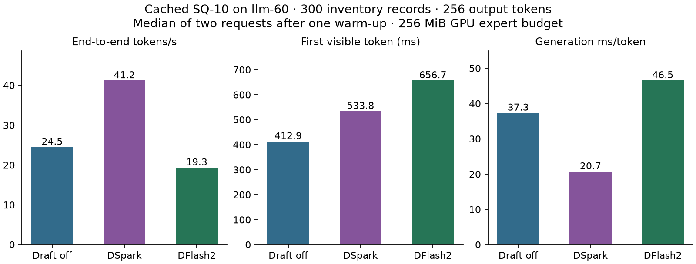

[Per-request timings and token hashes](docs/benchmarks/inkling/draft-http-matched.jsonl)

The chart measures seven-token DFlash2 proposals using the resident output head
and hidden states captured during SQ-10 prefill on llm-60. Each bar is the
median of three synchronized warm trials. Target verification and HTTP serving
add work beyond these timings. The 256 MiB run also released duplicate model
construction weights and used 512-token prefill calls. The 1,024 MiB run
exhausted VRAM while growing its KV cache to 126,976 positions.

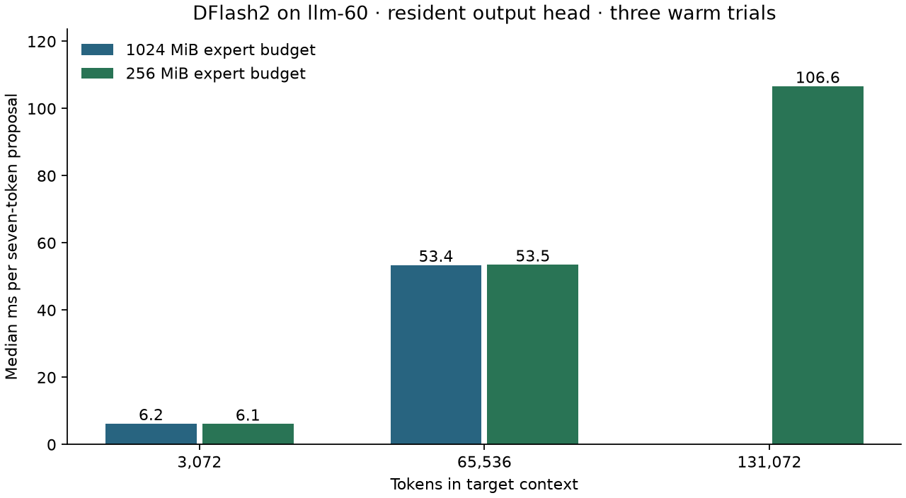

[Per-trial latencies and proposed token IDs](docs/benchmarks/inkling/dflash2-context-proposal.csv)

At 131,072 prompt tokens, staging the target embedding and output head in host
RAM allowed the direct verifier to commit 32 tokens on one repetitive log
continuation. The four target anchors and all 28 accepted draft tokens matched
an independent greedy decode. Hashes of all 200,058 logits matched at the
prompt boundary and after each eight-token block. The four proposal and
verification intervals totaled 3.487 seconds (9.18 committed tokens/s),
including the first proposal at 1.524 seconds. These timings exclude prefill,
anchor selection, instrumentation between blocks, and HTTP overhead.
[Block timings, generated IDs and target hashes](docs/benchmarks/inkling/dflash2-128k-verify.jsonl)

A 31-token SQ-10 chat prompt on llm-60 exercised RAM restore in a new target
lease in the same process. The test saved 9,928,704 target bytes and 571,392
drafter bytes together, and retained the target frontier and token history
separately. After clearing the hidden buffer and restoring both states,
all seven proposed IDs, the three committed IDs, and the final full-logit
hash matched uninterrupted generation. The native forward counter stayed at
34 throughout restore. [Run record](docs/benchmarks/inkling/dflash2-paired-ram.jsonl)

A fresh-process test then saved after the first generated token and exited.
A second process loaded both models independently, restored the target and
drafter from tmpfs, and generated the remaining chat framing tokens.
The proposed path and final full-logit hash matched uninterrupted generation.
The new target had processed zero tokens before and immediately after restore.
[Fresh-process run record](docs/benchmarks/inkling/dflash2-paired-restart.jsonl)

### Experimental Cached DSpark text serving

For the single-GPU unadapted greedy text profile, apply
`experimental/branching_context/native/inkling/dspark-checkpoint.patch` after
`portable-state.patch`, then rebuild the PCC bridge from this checkout.
Launch with `INKLING_EXACT_HEAD=1 python tools/inkling_pcc_serve.py RUNTIME --dspark`.
The selected output projection, drafting mode, and `CUBLAS_WORKSPACE_CONFIG` participate in checkpoint identity. Cached records the workspace value even when it is unset. Checkpoints created before workspace tracking require their original Cached version for restoration. Create a new checkpoint under the current profile to use it with this version.
The server commits a full verifier frontier at the end of each speculative block.
The `draft_nodes` counter reports proposed tree nodes. Updated bridges also report `drafts_accepted` for committed proposals under the stock greedy tree-walk accounting rule. Use the complete HTTP
operation, including root creation and branch acknowledgment, to measure
end-to-end throughput.
