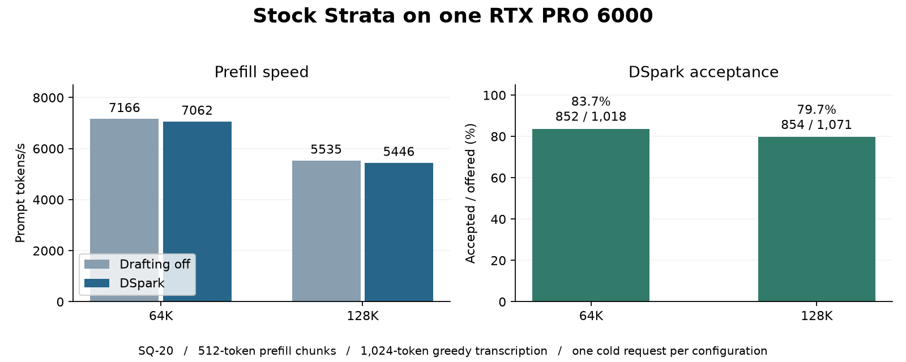
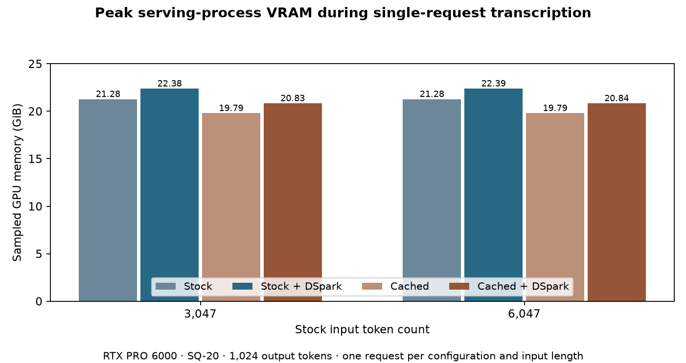

# Cached Inkling 2 Mini

This local PCC fork targets Thinking Machines Lab's Inkling 2 Mini. The
initial profile uses one RTX PRO 6000 Blackwell, one request and an 8,192-token
context. GPU count is a runtime setting for later trials.

## Measured performance

### 64K and 128K single requests

Each bar measures one cold request on one RTX PRO 6000 Blackwell, with SQ-20 weights, FP16 KV, a 512-token prefill chunk and a 1,024-token output. Each configuration starts a fresh server. Time to first visible token includes prompt processing. Peak GPU memory is sampled across the serving process and its children. The Cached client also times root creation and branch completion in the complete operation. All eight runs returned the same output text. Repeated questions on a shared parent require a separate warm-cache measurement.


[Download the underlying long-context measurements](docs/benchmarks/inkling/long-context.csv)

Stock Strata reported prompt processing speed and the number of DSpark draft tokens offered and accepted. Cached recorded proposed tree nodes only in these runs, so its acceptance rate is unknown.



[Download the prefill and proposal counts](docs/benchmarks/inkling/stock-dspark.csv)

### Three questions on one 128K document

BranchWrite loaded one station register, forked three siblings from the same parent and asked each a different lookup question. All three asks restored the resident parent and imported zero checkpoint bytes. Two answers were correct. The bars time parent loading and each ask through answer and receipt verification. Fork creation is outside the ask timer. Each bar is one observation.


[Download the shared-parent measurements](docs/benchmarks/inkling/resident-128k.csv)

### 3K and 6K single requests

One NVIDIA RTX PRO 6000 Blackwell, SQ-20 weights resident on the GPU, FP16 KV.
Each short-context HTTP throughput bar summarizes four single-request transcription trials
with 1,024 output tokens. The complete Cached request includes root creation
and the branch receipt. The generation panel uses each engine’s reported
generation time. Stock used a 2,048-token prefill chunk and Cached used 512.


The following memory measurements sample the serving process and its children
during one request per configuration. Host checkpoint RAM is excluded.



### Concurrent requests

The native concurrency sweep used independent 4,097-token prompts and 256
output tokens per slot. Each point is one run. At 54 slots the engine reached
1,006.9 aggregate tokens/s and 18.6 tokens/s per slot.


## Native inference baseline

Use the Linux x86-64 CUDA 13 `strata-inkling` 0.1.69 package from
[Strata 0.2.22](https://github.com/Niko1221/Strata/releases/tag/v0.2.22) and
`Inkling-2-Mini-SQ-20.strata` from the
[pinned checkpoint revision](https://huggingface.co/strata-engine/Inkling-2-Mini-Strata/tree/04996a1e2c45009b6a04f2af126cb6bdb2ba3587).
Extract the engine archive and place the checkpoint beside the executable. The
checkpoint uses about 18 GiB. On llm-60 both belong under
`/mnt/fast_cache/inkling`.

```bash
INKLING_DIR=/mnt/fast_cache/inkling tools/inkling_smoke.sh
```

The baseline uses FP16 conversation state and disables speculative decoding.

For a single-request HTTP endpoint, also place the pinned Strata checkout at
`strata-source` and the companion tokenizer files from the checkpoint revision
under `tokenizer`. Install `tokenizers`, `jinja2` and `regex` into the runtime environment.

```bash
python tools/inkling_serve.py /mnt/fast_cache/inkling
curl --fail-with-body http://127.0.0.1:18060/v1/chat/completions \
    -H 'Content-Type: application/json' \
    -d '{"model":"Inkling-2-Mini","messages":[{"role":"user","content":"What is 2 + 2? Reply with just the number."}],"max_tokens":128,"temperature":0}'
```

The HTTP endpoint binds to loopback and serves one request at a time.
For image input, install Pillow and put `Inkling-2-Mini-Vision.strata` from
the same pinned checkpoint revision next to SQ-20. Then run:

```bash
python tools/inkling_serve.py /mnt/fast_cache/inkling --vision
# From a second shell on the GPU host, once the service reports ready:
python tools/test_inkling_http.py
```

The test sends the same question with two different PNGs, verifies the
answers, checks text inference after an invalid model request, and verifies
that disconnecting a stream cancels generation and releases the slot.

## Building the native engine

Build the pinned Strata source with CMake and a CUDA toolkit that supports
SM120. On llm-60 the build uses CUDA 13.5 and writes to the fast-cache
runtime directory beside the released executable.

```bash
git -C /mnt/fast_cache/inkling/strata-source sparse-checkout add engine
tools/inkling_build_native.sh /mnt/fast_cache/inkling
/mnt/fast_cache/inkling/native-build/strata-inkling --version
```

`INKLING_NVCC`, `INKLING_CUDA_ARCHS` and `INKLING_BUILD_JOBS` can override the
compiler path, GPU architecture and build parallelism.

## PCC integration

PCC's Inkling CUDA adapter stores per-visit full-attention and sliding-window
KV, ShortConv state, and a separately stored full-vocabulary frontier. The
pinned profile consumes canonical text token IDs at 8K context with FP16 KV,
512-token prefill chunks, and drafting disabled. The HTTP service defaults to an 8 GiB resident checkpoint budget at 8K context and scales it up for longer contexts. Use `--ram-cache-gib N` to set the budget explicitly. The worker cache also has a 32-entry limit. Disk checkpoints use PCC's existing
checksummed envelope and bind the model, tokenizer, execution profile and
token history. An optional vision profile uses the pinned vision tower and
absolute-position image embedding rows. Its histories also bind the original
image, encoder profile, and exact embedding bytes. The Strata chat baseline
and the PCC token service have separate launchers.

The [upstream README](README-PCC.md) records earlier PCC model results. Those
results apply to their documented profiles.

## Serving performance

Establish a cold and warm single-request baseline on llm-60 before tuning.
Measure prefill rate, time to first visible token, decode rate, peak VRAM and
restore latency across short and long prompts. Track visible and reasoning
tokens separately.

Use exact FP16-state continuation as the reference for RAM and disk cache
tests. Then measure native FP4 kernels and DSpark drafting with the same
weights, prompts, decoding settings and context sizes. Explore selective
layer and expert residency when the full checkpoint exceeds available VRAM.
Compare concurrent requests after the single-request results are reproducible.

### Native checkpoint regression

Apply [the CUDA state patch](experimental/branching_context/native/inkling/portable-state.patch)
to the pinned Strata checkout. Build the standalone regression with
`-DINKLING_PORTABLE_STATE_TEST_SOURCE=/absolute/path/to/check_portable_state.cpp`
in the native CMake build directory. Then run:

```bash
cmake --build native-build --target inkling_portable_state_test
native-build/inkling_portable_state_test Inkling-2-Mini-SQ-20.strata write portable-test.bin
native-build/inkling_portable_state_test Inkling-2-Mini-SQ-20.strata read portable-test.bin
```

On llm-60 the 4,097-token fixture exported 305,856,512 bytes of native state.
RAM restore after a sibling write and disk restore in a fresh process
matched all 200,058 continuation logits bit for bit with CUDA, FP16 KV,
8K context, 512-token prefill chunks and DSpark disabled. The native-only fixture stores unframed test bytes. The PCC regression below
uses the durable checkpoint format.

### PCC CUDA checkpoint regression

With the CUDA state patch applied, configure the bridge from the local fork.
Keep an original copy of the pinned Hugging Face `tokenizer.json` named
`tokenizer-source.json` in the runtime directory. Strata's serving adapter
writes its converted tokenizer files to a different directory.

```bash
runtime=/mnt/fast_cache/inkling
cmake -S "$runtime/strata-source/engine/src/inkling2" -B "$runtime/native-build" \
    -DCMAKE_POSITION_INDEPENDENT_CODE=ON \
    -DINKLING_PCC_BRIDGE_SOURCE="$PWD/experimental/branching_context/native/inkling/inkling_bridge.cpp"
cmake --build "$runtime/native-build" --target inkling_pcc_bridge
export PYTHONPATH="$PWD/experimental/branching_context/src"
test_dir=$(mktemp -d "$runtime/pcc-check.XXXXXXXX")
python tools/test_inkling_pcc.py "$runtime" "$test_dir" write
python tools/test_inkling_pcc.py "$runtime" "$test_dir" read
```

The two-process regression passed on llm-60 with the pinned Strata source
`b28ca95e3e6847f2d5e317994f253b66716deeaa` and CUDA 13.5. RAM and disk
restore matched all 200,058 frontier logits and all 200,058 logits after one
continuation token. Restore consumed zero prefix tokens. A sibling write
preserved the parent. The test rejected changed model, execution and input
identities with valid manifest checksums, and rejected a flipped payload byte.
The 306,656,744-byte disk payload restored in 0.530 seconds in that run.
PCC's G0 reference suite passed 58 tests. Coverage here is the single-GPU,
text-token, draft-off profile with owned copies of the native state.

For the image-aware profile, place the pinned vision tower alongside the
text checkpoint and run the vision regression in a separate workspace:

```bash
test_dir=$(mktemp -d "$runtime/pcc-vision.XXXXXXXX")
python tools/test_inkling_pcc_vision.py "$runtime" "$test_dir" write
python tools/test_inkling_pcc_vision.py "$runtime" "$test_dir" read
```

On llm-60, the two images used identical text and placeholder token IDs and
produced distinct history IDs and frontier logits. Each image matched all
200,058 frontier and continuation logits through RAM restore after sibling
writes and disk restore in a fresh process. The native work counter recorded
zero replay. The fresh-process test had no image encoding step.

### PCC HTTP token and chat service

After building the PCC bridge, start the authenticated localhost service
with a private, temporary store under Linux `/dev/shm`:

```bash
python tools/inkling_pcc_serve.py /mnt/fast_cache/inkling
```

The temporary store holds checkpoint files and branch metadata in tmpfs and is removed on normal shutdown. This still uses RAM for serialized checkpoints in addition to resident cache entries. For restart and disk durability testing, pass `--persistent` to reuse the profile’s runtime directory or `--store PATH` to select a directory. Use the same option on both launches.

The launcher creates a private `pcc-http.key` in the runtime directory.
The service listens on port 18061 by default. It offers `/cow/create` and
`/cow/generate` for token IDs, and `/cow/text/create` and
`/cow/text/generate` for chat messages. Chat uses the pinned Inkling
tokenizer and template, with greedy decoding and thinking disabled. Install
`jinja2` and `regex` in the runtime environment. The separate Strata baseline
serves OpenAI-compatible text and vision requests on port 18060.

Run `tools/test_inkling_pcc_http.py RUNTIME FIXTURE write` against the live
service, then restart it with the same store and run the test in `read` mode.
On llm-60 the restart returned the same five tokens and the same numerical
payload SHA-256. The native counter recorded five forward tokens for the
five generated tokens. The same regression with `--chat` returned the
visible answer `4` before and after restart with the same numerical payload
SHA-256. The counter recorded three generated tokens and two appended
assistant framing tokens.

### PCC HTTP vision service

Start a separate Inkling vision profile with Pillow installed and the pinned
vision tower in the runtime directory.

```bash
python tools/inkling_pcc_serve.py /mnt/fast_cache/inkling --vision --port 18062
```

The default vision store is `pcc-vision-http-store`. Use `/cow/namespace`,
`/cow/images`, `/cow/text/prepare`, and `/cow/text/answer` for a prepared
image question. The service binds image inputs to the normalized bytes,
encoder profile, and embedding digest. It accepts PNG and JPEG uploads and
uses the same private bearer token as the text service. New image questions
currently use a new prepared prompt.

Run `tools/test_inkling_pcc_vision_http.py RUNTIME FIXTURE write`, restart the
vision service with the same store, then run the test in `read` mode.

### Output-head LoRA

The SQ-20 CUDA bridge can capture the frozen model's final normalized
hidden rows and pre-softcap logits. Train rank-4 LoRA factors on these actual
model features with AdamW or factorwise Muon. The same bridge applies the
exported low-rank delta before softcapping logits during serving.

Use CUDA PyTorch and NumPy in a separate training environment. The
qualification run used PyTorch 2.14.1+cu130 and NumPy 2.5.5 on llm-60.

```bash
runtime=/mnt/fast_cache/inkling
python tools/inkling_train_head.py "$runtime" "$runtime/lora-adamw" --optimizer adamw
python tools/inkling_train_head.py "$runtime" "$runtime/lora-muon" --optimizer muon
export PYTHONPATH="$PWD/experimental/branching_context/src"
store=$(mktemp -d "$runtime/pcc-lora-test.XXXXXXXX")
python tools/test_inkling_head_lora.py "$runtime" "$store" \
    "$runtime/lora-adamw/adapter.iklora" "$runtime/lora-muon/adapter.iklora"
```

Launch PCC with `--adapter /path/to/adapter.iklora` to attach the adapter.
Each adapter gets a distinct model contract and default store. Omitting the
option selects the base model. Keep training outputs and optimizer checkpoints
in local runtime storage.

Both optimizers updated the real model's output-head adapter and matched
the uninterrupted third step bit for bit after reading the two-step
checkpoint into a new optimizer. Training loss across three updates went
from 8.749 to 6.415 for AdamW and from 8.749 to 0.325 for Muon on the two
synthetic examples. These numbers measure the training fixture. Broader
QLoRA targets, fixed-rank consolidation between rounds, and skill evaluation
are separate qualification work.
Both adapters passed the authenticated PCC HTTP launch, root creation and
greedy generation test on llm-60. The endpoint receipts carried the expected
adapter-specific model identity. The native regression also verified exact
base logits after disabling the adapter and refused cross-adapter restores.

### DFlash2 and Splash

[Splash](https://github.com/incoai/splash) is an Apple Silicon engine with
Inkling 2 Mini DFlash2 support. Use its speculative serving and memory-planning design as a reference for
Cached Inkling. Evaluate the Inkling-specific DFlash2 drafter on CUDA for
llm-60 as an opt-in profile. Compare against DSpark and draft-off under matched conditions.
Include draft acceptance, verifier cost, memory overhead, and post-restore
continuation. Qualify the drafter's state and rejection rollback before
enabling it with PCC checkpoints.

### Experimental Cached DSpark text serving

For the single-GPU unadapted greedy text profile, apply
`experimental/branching_context/native/inkling/dspark-checkpoint.patch` after
`portable-state.patch`, then rebuild the PCC bridge from this checkout.
Launch with `INKLING_EXACT_HEAD=1 python tools/inkling_pcc_serve.py RUNTIME --dspark`.
The selected output projection and drafting mode participate in checkpoint identity.
The server commits a full verifier frontier at the end of each speculative block.
The `draft_nodes` counter reports proposed tree nodes. Use the complete HTTP
operation, including root creation and branch acknowledgment, to measure
end-to-end throughput.
