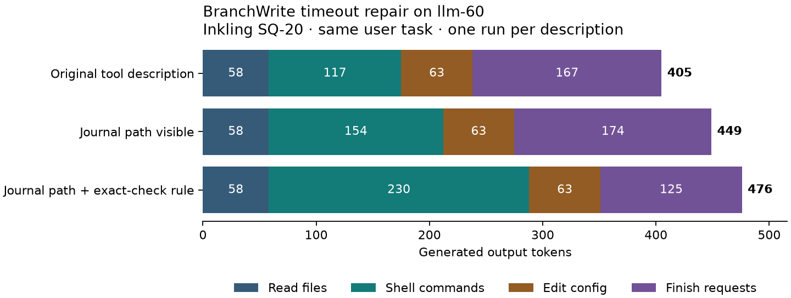

# Replay the timeout repair

Run from the root of a clean Cached checkout on Linux with a running user systemd manager and BranchWrite on PATH. The commands create a temporary fixture copy, reproduce the startup failure, apply the recorded repair, and probe the live service three times.

```bash
set -e
base=docs/benchmarks/inkling/branchwrite-systemd-repair
work=$(mktemp -d)
git archive HEAD "$base" | tar -x -C "$work"
(cd "$work" && git apply "$base/timeout/fixture.patch" && bash "$base/replay.sh")
```

The harness also checks rejection of a wrong archive digest and verifies that applying the valid archive twice preserves the systemd invocation ID. Replay uses the saved model output and requires no inference endpoint.

## Verified client installation

The replay passed with CPython 3.14.4 and a fresh, non-editable BranchWrite installation from commit `9d1d3528d9d357d9d9f1d42decacad25881e9172`. To install that CLI in an isolated environment before running the replay commands above, use:

```bash
client=$(mktemp -d)
git clone https://github.com/CC-David-CC/BranchWrite.git "$client/source"
git -C "$client/source" checkout --detach 9d1d3528d9d357d9d9f1d42decacad25881e9172
uv venv --python 3.14 "$client/venv"
uv pip install --python "$client/venv/bin/python" "$client/source"
export PATH="$client/venv/bin:$PATH"
```

## Decisions across the two live runs

The earlier SQ-20 runtime and the clean portable build each recorded six completed tool calls in this order. Both read the failed unit journal, read `worker.py`, read `service.json`, replaced the configuration, ran `python3 worker.py --check`, and finished. Each shell command returned zero. The model had explicit instructions to inspect the journal and run the check.

Both exported archives matched the published `fix.bw` byte for byte. Applying that archive to the clean-build incident's original project reproduced its entire repaired directory. The decision comparison covers tool names, targets, order and command results. The [per-decision ledger counts](decision-tokens.csv) matched at every step. Each run consumed 260 output tokens over six model requests. Editing the file consumed 62 tokens and the finish action consumed 74. These counts exclude prompt processing. Cross-build logit equivalence remains untested.

### Cost of discovering the journal



All three runs produced the correct configuration. Only the latter two read the failed service journal. The final description yielded one finish request and the highest total output cost. Each bar represents one run. [Per-action ledger counts](journal-discovery-tokens.csv)

### Replay the 1,375 ms transfer case

In the temporary checkout above, apply `timeout/transfer-1375.patch` after the timeout fixture patch and before invoking the harness:

```bash
(cd "$work" && git apply "$base/timeout/transfer-1375.patch" && bash "$base/replay.sh")
```

This selects the original 1,375 ms input and its separately recorded BranchWrite archive. The archive digest is pinned in the patched harness.
