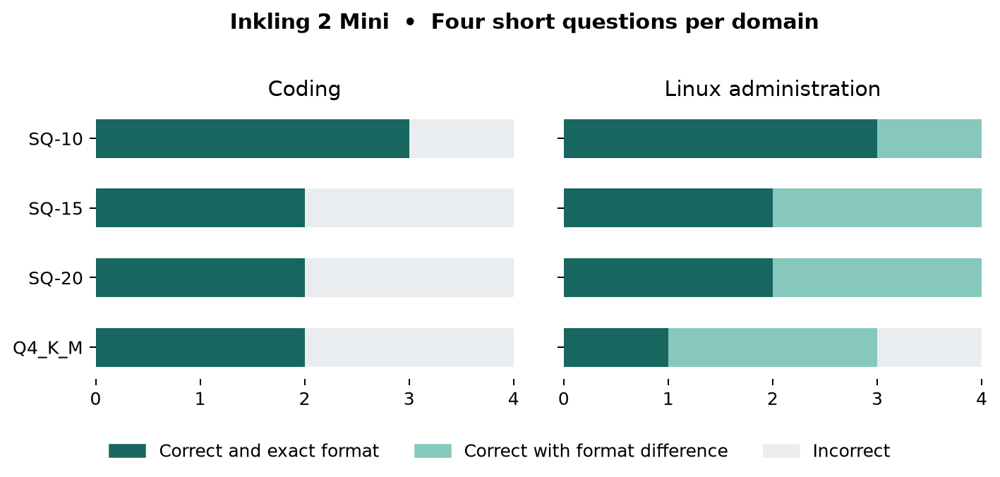
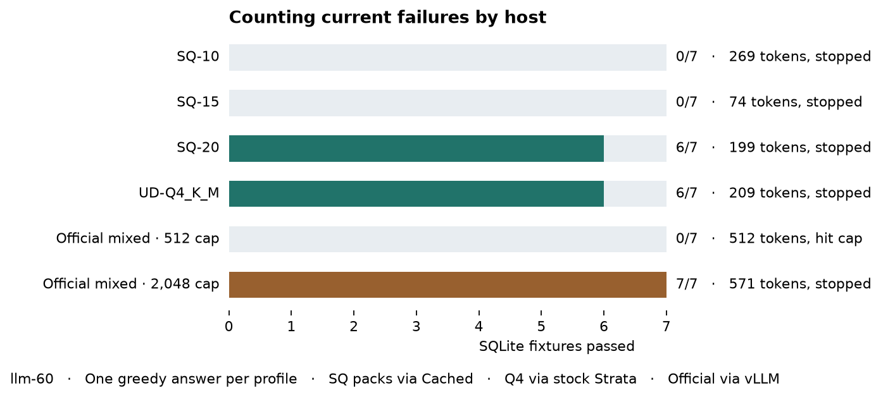
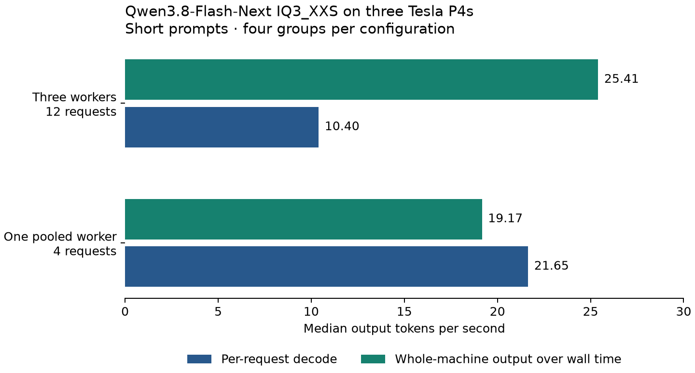
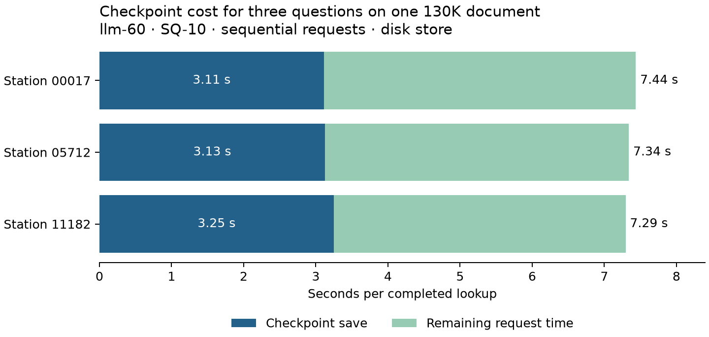
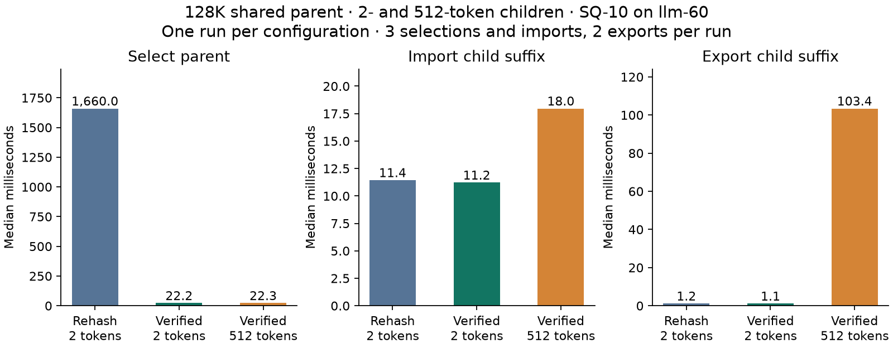
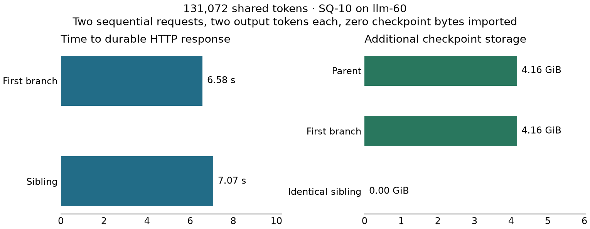
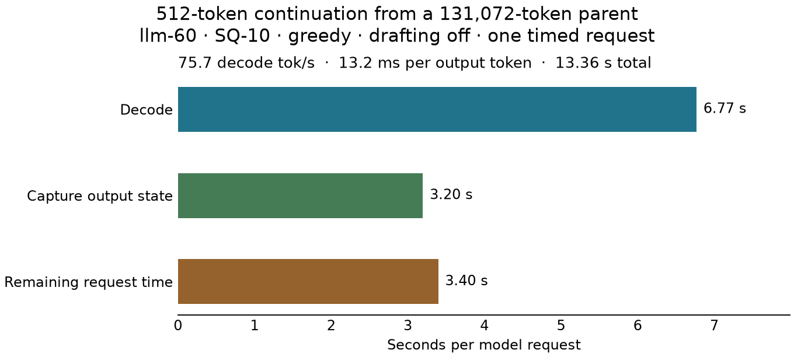
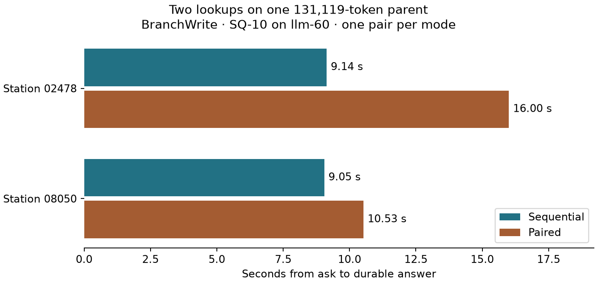

# Inkling 2 Mini qualification

Results cover the RTX PRO 6000 Blackwell on llm-60 unless a row identifies another host. A pass applies to the profile and workload described in its row. The [benchmark charts](../../../README.md#measured-performance) include sample counts and timings.

| Goal | Status | Verified result and remaining work |
|---|---|---|
| Executable SQL after 250k archive tokens | One fixture passed in two processes | Both SQL queries returned all five expected rows, covering tied timestamps, duplicate station names, null readings and stations with no usable readings. Output token sequences matched and child payload hashes matched across restart. The schema followed 250,000 archive tokens. This tests executable SQL with a long prefix and the schema near the question. [SQL runs](branchwrite-250k-sql.csv) |
| HTTP cumulative checkpoints across turns | Published, reopened after restart and continued on llm-60 | The worker saved 15,040,512 native state bytes plus an 800,232-byte logit row for the second turn. After restart, the HTTP resume route reproduced the same 12 token IDs and all 200,058 terminal logits as continuation from the full checkpoint. Each request forwarded exactly 12 tokens. This example preserves the model’s incorrect lookup answer. [Live measurements](branchwrite-250k-cumulative-http.json) |
| Compact second-turn checkpoint relative to the original document | Native reconstruction passed | From the saved 250,064-token parent, the worker restored the first-turn suffix and consumed the recorded second turn. The resulting 15,040,512-byte cumulative suffix reconstructed the 8,367,570,944-byte native state. Hashing the reconstructed state and its frontier reproduced the independent full HTTP checkpoint digest. [Measured sizes and digest](branchwrite-250k-cumulative.json). A separate worker also reopened the parent and cumulative suffix, matched the full payload checksum at 250,121 tokens, and recorded zero forward tokens. [Two-process regression](../../../tools/test_inkling_cumulative_restart.py) |
| Second chat turn from a saved 250k child | Restart exact; lookup incorrect in both runs | Two fresh workers reopened the child and appended the same user message. They matched all 24 output tokens and the durable payload checksum in 29.82 and 33.39 seconds. Each forwarded 39 tokens. Both missed the expected label. Releasing the temporary full parent after native suffix restore kept child publication within the existing host-memory reserve. These timings used full grandchild checkpoints as the control for the subsequent cumulative-save trial. |
| HTTP disconnect on a 250k parent | Cancel and recovery passed in one live trial | After warming a 250,064-token register, the client sent a follow-up containing 8,000 repetitions of a word and disconnected eight seconds after receiving stream headers. The operation changed from running to cancelled in 1.11 seconds after close. The branch kept its original revision and tip. A new sibling reproduced the control's three output tokens and checkpoint checksum. |
| Serial follow-up text on the 250k BranchWrite register | All three child hashes and token sequences reproduced | SQ-10, one RTX PRO 6000, exact GPU expert execution, 4 GiB expert pool, FP16 device KV, greedy decoding. All six visible answers were correct. The fresh worker imported the parent once. Both later lookups imported zero checkpoint bytes. [Serial follow-up timing and hashes](branchwrite-250k-serial.csv) |
| BranchWrite chat on a 250k-token randomized register | Retrieval passed; checkpoint reproducibility remains open | Across two processes, all three randomized lookups returned the expected visible label and identical generated token IDs. 0 of 3 child payload hashes matched. Each process imported the 250,064-token parent for its first question, then served two warm questions with zero checkpoint import bytes. [Six durable timings and hashes](branchwrite-250k-lookup.csv). Byte comparison found differences in both native state and frontier logits in every pair. The largest absolute logit difference ranged from 0.69 to 1.46, with the same next-token argmax in all three pairs. [State and logit comparisons](branchwrite-250k-byte-diff.csv). In fresh native workers the first 15-token question batch already produced different logit rows, including with adaptive expert tiering disabled. Feeding the same 15 input tokens individually reproduced every measured row across two workers, including the next three forced output tokens. This probe covers one question and a common stored parent. [Per-stage replay hashes](branchwrite-250k-question-replay.csv) |
| Native child checkpoint export | Exact restart passed for two SQ-10 branches on llm-60 | A 1,017-token parent plus an 18-token continuation produced a 7,372,800-byte suffix for a 205,520,896-byte child. A 1,537-token parent plus 1,027 tokens replaced the entire sliding window and produced a 205,258,752-byte suffix for a 255,623,168-byte child. Both reconstructed states matched the full export, and both fresh processes matched all 200,058 next-token logits. Single-GPU FP16 KV, drafting off. The 250k HTTP stopped-turn test also reconstructed the saved branch in a fresh process. [Follow-up receipts](http-stop-250k-single-hash.json). [Build and run](../../../README.md#native-parent-plus-suffix-regression) |
| Reproducible install | Partial | A clean public checkout built the pinned CUDA bridge and passed text and vision checkpoint tests in a new virtual environment. Fresh-machine provisioning of CUDA and model assets is open. |
| Text serving | Pass for greedy single requests | PCC HTTP reproduced output tokens and checkpoint hashes after restart with zero saved-prefix replay. |
| cuBLAS workspace checkpoint isolation | Pass for SQ-10 token HTTP on llm-60 | Three server processes used one RAM-backed store. A checkpoint created with `:4096:8` returned HTTP 409 on generation under `:16:8`. Restoring `:4096:8` allowed the original branch revision to generate the same five tokens and payload SHA-256 with five native forward steps. |
| Vision serving | Pass for the prepared image path | Red and blue uploads produced distinct answers. Restored image frontiers and one-token continuations matched all 200,058 logits. On two 224×224 images with identical red/blue pixel counts and reversed halves, the prepared-image HTTP route correctly identified the left color in both. A fresh process reproduced both token streams and checkpoint payload hashes with zero prompt replay. The combined four-image regression later matched all answers and tokens after restart, but the left-blue case produced a different checkpoint payload hash. Only three of four payloads matched in that run. Reading native state first and frontier logits last, 198,966 of 200,058 left-blue logits differed bitwise (maximum absolute difference 0.001202), with the same argmax. The native payload differed in 75,506 ShortConv bytes, 490 key bytes and 343 value bytes. Eight identical continuation inputs gave the same eight argmax IDs but different logit rows. Reimporting the original payload also gave different rows on all eight steps, so the between-checkpoint difference alone cannot explain the continuation variance. [Continuation control](vision-spatial-continuation.csv). [Payload comparison](vision-spatial-restart-diff.csv) and [per-visit differences](vision-spatial-restart-visits.csv). With STRATA_INK_EXACT=1 and the same cuBLAS workspace, two independent write/restart trials passed all four images each. Every case also reproduced its payload hash across trials. The same four-image HTTP suite passed on the RTX 4090 in llm-49 under the forced-GPU settings. One restart reproduced all four token streams and payload hashes with zero prompt replay. Across the two hosts, all four generated token sequences matched, but every final checkpoint hash differed and only the left-red final frontier had the same argmax. The original prepared snapshots contained identical normalized image hashes, embedding bytes and text token IDs on both hosts for all four cases. All four prefill logit hashes already differed, while each prefill argmax agreed. [Prepared-input comparison](vision-cross-host-prefill.csv). [Cross-host results](vision-cross-host.csv). The auto-selected CPU cold-expert profile on llm-60 retains its recorded failure. [Forced GPU expert results](vision-forced-expert-restart.csv). |
| Request lifecycle | Pass for single-worker text | Disconnecting a streaming request preserved its branch and allowed a registered second request to finish identically to its control. Invalid lengths and stale revisions preserved the branch. On r730, all three disconnect trials on each of the two-P4 and three-P4 SQ-10 workers preserved the cancelled branch and reproduced the control tokens and checkpoint hash on the queued branch. [Six live trials](p4-live-cancellation.csv). |
| State exactness and isolation | Pass for pinned FP16 KV | RAM and fresh-process restore matched full logits before and after continuation. Sibling writes preserved the parent. Invalid identities and corrupt payloads were rejected. |
| Export checksum reuse | Passed all three SQ packs on llm-60 | A fresh process independently verified each 4,423,680-byte checkpoint and reproduced all 200,058 logits at restore and after each of two continuation tokens. Each test used three prompt tokens and 16,384-token capacity. [Recorded hashes](llm-60-export-restart.jsonl) |
| Physical prefix reuse | Passed for serial branches on one pinned device parent | In the 250k SQ-10 test, three different register lookups restored the same native parent in 11–13 ms each. With HTTP suffix checkpoints, the uninterrupted follow-up imported 4,620,288 bytes and the restarted worker imported 8,369,176,576 bytes. Both produced identical tokens and child checksum. These trials establish reuse across serial requests; concurrent live-branch memory scaling remains open. [Native lookups](warm-250k-native-draft.csv) · [HTTP restart receipts](http-stop-250k-single-hash.json) |
| AdamW output-head LoRA | Pass for rank 4 | Training CLI resumes matched uninterrupted losses, serving bytes and step-four optimizer state on the two-example fixture. |
| Factorwise Muon output-head LoRA | Pass for rank 4 | The same fresh-process and chained-resume checks passed. The second eight-step station round gained six answers and lost six. |
| Adapter serving and cache identity | Pass for tested head adapters | Both exported adapters launched over HTTP and restored after restart. Backend checks rejected cross-adapter reuse and recovered the exact base frontier when disabled. |
| SQ-10 and SQ-15 output-head LoRA | Training and native adapter serving passed on llm-60 | AdamW and factorwise Muon each reproduced the complete third optimizer step and exported adapter bytes after a fresh-process resume. The two adapted frontiers differed on each pack, cross-adapter checkpoint restores failed, and disabling the adapter recovered the full base frontier. An SQ-20 adapter was rejected on SQ-10. The SQ-10 Muon adapter also reproduced five generated tokens and the checkpoint hash over HTTP after a fresh server restart on one Tesla P4, forwarding five tokens. The loss measurements use two synthetic training examples. [Training receipts and frontier hashes](sq-head-lora.csv) |
| SQ-15 chmod training and serving | One of two training cases corrected on llm-60 | The base failed both scripts. The trained AdamW head correctly cleared setgid across all three file modes. On the setuid case it left the privileged bit set. Muon passed zero of two complete scripts. Both adapters exhausted the 2,048-token budget on a related mode question that base SQ-15 answered correctly. Broader retention remains open. [AdamW scripts](linux-mode-command-adamw.csv) · [Muon scripts](linux-mode-command-muon.csv) · [AdamW retention](linux-mode-command-retention.csv) · [Muon retention](linux-mode-command-muon-retention.csv) |
| SQ-15 failure-only second round | Fixed-rank export, serving and adapter isolation passed on llm-60 | AdamW trained a fresh residual on the remaining failed script. The rank-8 parent plus residual and its rank-4 compression produced identical tokens on both scripts, with one correct. Their full logits differed at all four tested positions. Fresh processes rejected the other adapter’s checkpoint in both directions and reproduced their own frontier with zero forwarded tokens. [Round results](linux-mode-command-rounds.csv) · [Command replay](linux-mode-command-adamw-round2.csv) · [Logit differences](sq15-round2-rank-logits.csv) · [Checkpoint isolation](sq15-round2-rank-isolation.jsonl) |
| Transformer-layer LoRA and QLoRA | Component and vLLM reference tests passed | Rank-4 AdamW and factorwise Muon reproduced the third update and optimizer state after restart on a locally quantized 4-bit layer-0 query projection. Muon’s exported factors reproduced all 58,368 calibration outputs. Serving that adapter on the official mixed-precision model in vLLM changed eight first-token distributions. On eight complete answers, it lost one Linux answer and gained none. Disabling it restored every original answer. End-to-end training through the backbone, native Cached serving and internal-adapter cache isolation remain open. [Answer transitions](internal-lora-retention.csv) |
| Training on the latest misses | Completed one SQ-20 rank-4 AdamW pilot | Eight steps on three corrections took the base from 51/54 to 14/54. Subsequent updates used all misses from the previous round. Steps 11 and 16 reached 53/54. The final evaluation brought the ledger to 93,362,144 tokens, with 12 cases never used for gradients. Repeated evaluation makes this a development score. [Scores, gains and losses by step](failure-only-rounds.csv) |
| Fixed-rank rounds and retention | Partial | A fresh rank-4 residual combined with its rank-4 parent. Compressing the rank-8 sum to rank 4 lost one correct answer. Both optimizers reproduced the compressed export after a process restart and trained another round using it as the parent. On SQ-10, both optimizers also reproduced the second-round rank-4 compressed export and complete third optimizer step after restart. On two executable tasks, a second Muon round lost the base’s file-mode answer at combined rank 8 and remained wrong after compression to rank 4. AdamW retained it at both ranks. No profile fixed the SQL miss. [Per-task retention](sq10-round-retention.csv). Broader independent skill evaluation remains open. |
| Gain and regression tracking | Pass for the station evaluation | Per-question records preserve corrections and prior successes and identify gains and losses at every round. Failure-only practice reached 53/54 on the repeated register. On a fresh register the step-11 candidate retained 21 of 22 base successes, regressed on one and fixed neither base miss. [Paired answers for all 24 stations](fresh-register-paired.csv). The base remains the default. |
| SQ-10 and SQ-15 vision restart | Passed on llm-60 | Each pack answered four color and spatial questions correctly. A fresh process reproduced the checkpoint hash and generated tokens in every case. One restart per pack. [Case results](vision-pack-restarts.csv) |
| Linux service-status SQL | Executed one greedy answer per SQ pack through Cached on llm-60 | Count failing services by host from the latest timestamp and sequence, preserving healthy hosts. SQ-10 supplied multiple statements and SQ-15 compared a two-column tuple with a single-column subquery. Both failed all seven fixtures. SQ-20 passed six, then failed a case where the latest failure had a lower sequence than an older success. Its query independently maximized timestamp and sequence. Stock Strata UD-Q4_K_M also passed six of seven and missed the lower-sequence newest failure. The official NVFP4/MXFP8 vLLM deployment reached the 512-token cap and returned incomplete SQL, failing all seven at this budget. With a 2,048-token cap it stopped naturally after 571 completion tokens and passed all seven fixtures. [Longer-budget run](linux-service-sql-official-2048.csv). [SQ results](linux-service-sql.csv) · [Reference runs](linux-service-sql-references.csv) · [Executable fixtures](check_service_sql.py) |
| Historical Python grader repair | One greedy attempt per profile on llm-60 | Given the grader from the parent of ba0693f, fix empty-result column validation and support recursive queries. The historical grader passed 6/9 checks and the committed repair passed 9/9. Cached SQ-10 passed 5/9, SQ-15 and SQ-20 each passed 6/9, and stock Strata Q4 passed 7/9. vLLM with the official NVFP4/MXFP8 checkpoint exhausted 1,536 completion tokens without returning a visible function, receiving zero credit. An 8,192-context rerun exhausted 4,096 completion tokens and again returned no visible function. [Longer-budget checks](historical-grader-repair-4096.csv). [Per-check results](historical-grader-repair.csv) · [Executable regression checks](check_grader_repair.py) |
| Coding and Linux quantization pilot | Measured on llm-60 | With every expert resident, stock Strata answered eight short questions using each pack. SQ-10 got seven underlying answers right, SQ-15 and SQ-20 six each, and Unsloth UD-Q4_K_M five. Greedy decoding, reasoning off, one attempt per question. Task execution and full-repository repair remain outside this pilot. [Domain scores](quant-pilot.csv) · [Model file sizes on llm-60](quant-pack-files.csv) |
| Resident continuation with explicit exactness settings | Repeat pass on llm-60 | On the 737-token Linux prompt, current SQ-20 with 133,120-position capacity, a 1,024 MiB GPU expert budget, GPU execution of cold experts and a fixed cuBLAS workspace repeated one checkpoint payload hash across five one-token probes. Three complete 147-token answers also repeated one payload hash and each got 13/18 counts right. Every request used one resident-parent restore and zero checkpoint import bytes. A second fresh process with a new RAM store regenerated the prompt and reproduced all 147 tokens and the complete payload hash across three more requests. [Six-request restart comparison](linux-rollup-exact-restart.csv). |
| Matched SQ packs on Linux exit counts | Measured on llm-60 | With a 1 GiB GPU expert budget and GPU execution for cold experts, SQ-10 counted 16/18 services correctly, SQ-15 counted 15/18 and SQ-20 counted 13/18. Each returned all 18 keys and repeated its payload hash in three trials on the same 97-record prompt. [Per-request results](linux-rollup-sq-packs.csv). A stock Strata UD-Q4_K_M reference counted 14/18 using 147 completion tokens in each of three requests. Under the same stock Strata settings SQ-10 counted 15/18 with 202 completion tokens. Stock SQ-15 counted 14/18 and stock SQ-20 counted 15/18. All four stock packs reported 738 cached prompt tokens on both repeats. [Stock pack comparison](linux-rollup-stock-packs.csv). Across all seven configurations, worker-17 was the only count every configuration missed. Cached SQ-10 corrected four SQ-20 misses and introduced one on worker-07. [Expected and generated counts per service](linux-rollup-per-service.csv). [Error chart](linux-rollup-per-service.png). |
| Linux exit-count summary | Three fresh branches per SQ-20 endpoint on llm-60 | For the same 97 records, the text endpoint (18061) counted 14/18 services correctly, the long-context endpoint (18069) counted 15/18, and the vision-enabled endpoint (18062) counted 11/18 using a text-only prepared chat. Every endpoint repeated its own 147-token sequence in all three requests. Each missed at least one count. On the long-context endpoint, three hash-verified checkpoints had the same input identity and consumed length (886), yet each pair differed in at least 200,057 of 200,058 saved logits. All selected token 200006 next. [Saved frontier comparison](linux-rollup-frontier.csv). Five one-token requests each reused the resident parent with zero imported bytes and three forward tokens, yielding three distinct saved logit rows. The service loaded SQ-20 with 1,472 GPU experts and 1,600 host experts, selected CPU evaluation for cold experts, and had no explicit cuBLAS workspace setting. Its native bridge SHA-256 was `c20fbc1b3920e39ba71c13140955b05e7e857a173a42be64e68760d7256a65a7`. These measurements apply to that build and placement. [Resident continuation counters](linux-rollup-resident-continuation.csv). [Per-request results](linux-rollup-repeats.csv) |
| Executable SQL and Linux tasks | SQ-20 comparison on llm-60 | Three requests per task and engine gave repeatable answers. Cached passed the file permissions task and stock HTTP passed the SQL task. In a separate native score probe with a 9 GiB GPU expert budget and GPU evaluation of cold experts, the top two SQL tokens reversed order relative to the verified Cached checkpoint after 20 common output tokens. Both picked the same permissions token after 11 common tokens. Adding a native checkpoint boundary immediately before the assistant opener changed the SQL winner and reproduced all 51 Cached SQL tokens and all 13 permissions tokens. The top scores still differ from Cached. Live stock HTTP logits remain open. [Frontier scores](sq20-frontier-comparison.csv) |
| Exact restore versus fresh prefill | SQ-15 split-prefill divergence reproduced on llm-60 | The same 70 prompt token IDs, 1 GiB expert budget and two forced continuation tokens produced different greedy choices. After one 70-token prefill, end-of-message led newline by 0.384 logits. With the opener in a separate two-token call, newline led by 0.701. The Inkling profile records a 512-token prefill chunk limit. Its checkpoint manifest binds the saved numerical bytes and input identity but omits the individual prefill call boundaries. Exact restore of a saved checkpoint and exact regeneration from token history are separate claims. A separate writer and reader process on llm-60 reproduced all 200,058 logits after each of two forced continuation tokens for both schedules. [Fresh-process restore](linux-special-mode-fresh-restore.jsonl) · [Logits for both schedules](linux-special-mode-prefill.jsonl) · [Repeated HTTP outcomes](linux-special-mode-sq15-repeats.csv). |
| Reasoning continuation after an HTTP process restart | Passed on llm-60 with undrafted SQ-10 | At effort 0.99 a fresh server reopened a tmpfs store after an eight-token cut. The combined continuation matched the uninterrupted 72 token IDs, the visible answer 391 and all 191 reasoning characters. Token hashes use little-endian uint32 IDs and text hashes use UTF-8. [Control and resumed hashes](effort-http-process-restart.json) |
| Numeric effort over PCC HTTP | SQ-20 passed on llm-49 and SQ-10 passed on llm-60 | A fresh llm-60 process used 8,192-token capacity, a 4 GiB expert pool, exact GPU expert execution and tmpfs checkpoint storage. Efforts 0, 0.01, 0.1, 0.543 and 0.99 answered the arithmetic fixture. Streamed text and reasoning matched the final response. A split at eight tokens reproduced the uninterrupted 0.99 result. Seven invalid values produced the numeric validator’s HTTP 400 response. Legacy llm-60 listeners on ports 18061 and 18069 rejected even 0.5 as an unsupported field. [HTTP regression](../../../tools/test_inkling_numeric_effort.py) |
| Reasoning effort on Linux permissions | One graded question per pack and setting on llm-60 | At effort 0.99 with a 2,048-token limit, SQ-15 returned the verified mode 2755 after 1,603 tokens. SQ-10 and SQ-20 exhausted the allowance before a visible answer. SQ-15 at effort 0.50 returned 2754 after 822 tokens. Both SQ-15 runs reproduced the first 512 tokens from the shorter trials. [Speed and answer chart](linux-special-mode-high-effort-packs.png) · [Pack measurements](linux-special-mode-high-effort-packs.csv) · [SQ-15 budget comparison](linux-special-mode-effort-2048.csv). |
| Official mixed-precision reference | Measured on llm-60 | The same eight questions ran on the official NVFP4/MXFP8 checkpoint (revision c9d0283) with vLLM b9fc915ee, greedy decoding and effort zero. The indexed main checkpoint contains 19.526 GB of tensor payload. The separate MTP file occupies 0.636 GB on disk. [Tensor storage by file and dtype](official-checkpoint-storage.csv) · [Routed experts, shared language tensors and vision](official-component-storage.csv). Native chat yielded zero visible answers at 64 output tokens and seven exact answers at 512. With Strata’s visible-answer opener and a 64-token limit, all eight answers were visible and four matched exactly. In the executable pilot, native vLLM chat returned a correct SQLite latest-per-host query (381 completion tokens) and an exact symbolic chmod operand (316). Both passed three fixtures. There was one greedy attempt per task at a 512-token limit. The Q4 Strata executable run used 213 host experts. [Executable scores by pack](executable-quant-pilot.csv). These measurements include differences in serving engines and prompt handling. [Reference scores](official-quant-pilot.csv) |
| Stock Strata comparison | Measured for single cold requests | Matched 64K and 128K transcription runs cover generation speed, complete throughput, TTFT and GPU memory. Stock was faster end to end. Repeated long-context tail latency and shared-parent crossover remain open. |
| DSpark at 65,536 input tokens | Greedy output passed. Final score repeatability failed with drafting | Four independent SQ-10 workers generated identical 512-token outputs and agreed on all 200,058 prefill scores. The two undrafted final score rows matched bit for bit. The two DSpark final rows differed at every position, with the same winning token. Generation took 3.50–3.64 seconds with DSpark and 6.27–6.28 seconds undrafted. This test compares uninterrupted workers on one register. [Pairwise comparisons](dspark-64k-frontiers.csv) · [Worker timings](dspark-64k-frontier-runs.jsonl) · [Reproduction instructions](frontier64/README.md) |
| DSpark | Experimental | Acceptance, speed, VRAM and restart continuation were measured for greedy unadapted text. A native linear-proposal test forced rejection after retaining 1, 4 or 7 positions. All four continuation rows matched the sequential reference in each of 12 cases. Verifier-only timing and forced rejection on the production tree path remain open. [Forced rollback results](dspark-forced-rollback.csv) |
| DFlash2 HTTP lifecycle | Pass for short, single-GPU SQ-10 greedy text | After a service restart, a branch resumed after its first generated token and consumed exactly two target steps for the two remaining tokens. Three streaming disconnects preserved their branch revisions while queued requests matched their controls. A GPU-resident server rejected a host-staged checkpoint, and reopening the original placement recovered the branch. [Restart and cancellation](dflash2-http-lifecycle.json) · [Placement isolation](dflash2-placement-isolation.json) |
| Long-document retrieval on llm-60 | Three of three SQ-10 register lookups passed | Three 111,328-token prompts placed unique station readings at 12.21%, 49.42%, and 88.94% of the input. Each visible answer matched the source reading. The native control used one GPU, 512-token prefill batches, 256 MiB of GPU experts, and 32 fixed greedy decode steps per request, including tokens after the first message boundary. [Per-position grading and timings](llm60-111k-registers.csv) |
| DFlash2 long-context exactness | Pass on one 131,072-token SQ-10 native prompt | Across 32 generated tokens, the target accepted all 28 draft tokens on a repetitive log. An independent greedy run matched every output ID and all 200,058 logits at the prompt boundary and each of four block ends. A separate SQ-10 HTTP run loaded 65,536 document tokens and saved after the first answer token. A fresh service imported 2,320,531,456 target bytes and emitted the final two tokens in two target steps. The full output matched the independent control. This covers graceful restart on one document. [64K HTTP restart](dflash2-64k-http-restart.json). [Per-block evidence](dflash2-128k-verify.jsonl) |
| Matched single-request drafting performance | Measured on llm-60 with 256 MiB of GPU experts | On the same 300-record prompt, all twelve HTTP requests produced identical 256-token outputs. Warm median end-to-end rates were 41.20 tok/s for DSpark, 24.46 for drafting off, 23.02 for GPU-resident DFlash2 and 19.33 for host-staged DFlash2. Each configuration ran one warm-up and two measured requests. The comparison covers this expert placement and workload. [Timing chart](draft-http-matched.png) · [Per-request counters and output hashes](draft-http-matched.jsonl) |
| DFlash2 verifier development | Native and offline experiments on llm-60 | Pinned the [Inco AI checkpoint](https://huggingface.co/incoai/Inkling-2-Mini-DFlash2/tree/4f9088ea66c21f2b99ed657d1941c306b03e84d2). Its 989,975,616-byte weights file has SHA-256 `217980ab00d116693fa5946df7bbfd967caf5fac1f529afd541fbd470ddb54ee`. The config requests target hidden states at indices 5, 23, 41 and 48. The BF16 fusion projection has shape 2,304 × 9,216. The checkpoint proposes eight positions with 16 candidates per position. An offline probe used live SQ-10 capture buffers via host RAM and the official target embedding and output weights. Across five first blocks, learned embedding RMS normalization increased the sum of greedy matching prefixes from 0/35 to 19/35 tokens. One first-token rejection recovered two sequential full-logit rows after parent restore. Rewinding to the pre-verification position and replaying accepted tokens one at a time matched four subsequent full-logit rows on four original proposals and at every acceptance depth from zero through seven on a repeated-text prompt. Direct retention of the batched prefix failed the full-logit check. A four-block offline walk per prompt matched 17/28 Python, 19/28 Linux and 9/28 JSON proposal positions before the first mismatch in each block. Each block prefills the extended prefix from scratch after advancing by one anchor and the matched tokens. A separate SQ-10 target decoded 40 greedy tokens per prompt with one persistent KV slot and captured four hidden layers at every step. Offline proposals against those traces matched 45/84 again, but the first two Python blocks changed from 2 and 1 matches to 3 and 0. This comparison also changes the capture executable and enables decode-step taps. On the Python prompt, an identical-executable control repeated in a fresh process with decode taps disabled diverged at token four and differed on all 41 full-logit rows, including prefill. Enabling decode taps preserved all 40 greedy tokens relative to the first control but also differed on every row. This hybrid SQ-10 profile has no demonstrated fresh-process full-logit reproducibility. [Tap capture and repeat control](dflash2-tap-parity.csv). With all 3,072 experts resident, three fresh processes agreed on all 40 greedy tokens. Two had identical 41-row logit traces with decode capture toggled. The third differed from both on every row, starting at prefill. [Resident repeat control](dflash2-resident-parity.csv). A fixed-token repeat on prefixes of the same Python prompt produced one distinct full trace in three processes at each of 12, 16, 17 and 20 input tokens. At 23 tokens, all three processes produced different prefill logits but the same 40 output tokens. [Fixed-input length comparison](sq10-resident-prefill-repeats.csv). Keeping those same 23 IDs fixed, a 16+7 prefill gave one bit-identical trace in three processes and the same 40 output tokens as single-call prefill. Token-at-a-time prefill also repeated exactly but yielded different tokens. Single-call prefill produced two distinct traces in three contemporaneous controls. [Fixed-input chunking hashes](sq10-fixed-input-chunking.csv). With a single 23-token prefill, eight fresh processes using CUBLAS_WORKSPACE_CONFIG=:4096:8 produced one full-logit trace, while eight controls produced two. All 16 emitted the same 40 tokens. Coverage is one prompt and one fully resident SQ-10 profile. [Workspace trial hashes](sq10-cublas-workspace.csv). On the same 23 tokens with 1,577 host experts, the fixed workspace still yielded three different prefill rows in three processes. A 3,072-token synthetic log prompt repeated bit for bit within each of four combinations of placement and workspace (three processes each). [Extended workspace results](sq10-workspace-extended.csv). On the 23-token hybrid reproducer, both adaptive tiering and its fallback placement yielded four distinct prefill rows and two output sequences across four processes each with fixed cuBLAS workspace. Disabling adaptive tiering changed the loader allocation to 1,435 GPU experts and 59 promotion slots. [Hybrid tier trials](sq10-hybrid-tier-repeats.csv). A live two-process prototype connected the PyTorch drafter to a persistent hybrid SQ-10 target through host RAM. Over eight blocks per prompt, serial greedy verification accepted 91/168 proposals and committed 115 tokens including anchors. Decode-loop rates were 18.16 tokens/s on Python, 30.38 on Linux and 23.06 on JSON, one run each. Timing excludes startup and prefill. The prototype rebuilds drafter context, transfers output weights per block and verifies one token per target call. On a 3,072-token synthetic administration log with 259 committed tokens, retaining the target hidden states on the GPU and transferring only new rows cut tap reads from 3.89 GB to 122.50 MB and raised live decode from 42.27 to 55.95 tokens/s. Both configurations kept the output head resident and used serial verification, one run each. [Longer live trial](dflash2-3072-tap-transfer.csv). On a matched rerun, plain SQ-10 generated all 259 IDs identically at 87.44 tokens/s versus 56.18 for live DFlash2 with serial verification. [Plain greedy control](dflash2-3072-greedy-control.csv). A live batched verifier retained 31 fully accepted blocks and rewound the other two for serial verification. It reproduced all 259 control tokens at 75.65 tokens/s versus 87.49 plain on this prompt. Full-logit parity failed in an instrumented rerun. The prefill row matched exactly and both modes emitted the same 256 tokens, but each of the 256 subsequent rows differed. All 257 argmax IDs matched. [Per-token logit differences](dflash2-batch-logits.csv). Rewinding every linear tree verification to its starting position and consuming accepted tokens serially reproduced all 260 full-logit rows and all 259 emitted IDs against a fresh plain control across 33 live blocks on the same prompt. [Live replay parity](dflash2-live-replay-parity.csv). After the first replayed block at position 3,080, a fresh target process imported the 272,531,456-byte portable state and consumed the separately saved greedy anchor. All 32 subsequent full-logit rows matched the uninterrupted run without prompt prefill. This covers target-only restart through RAM-backed files. A fresh target and drafter then resumed from position 3,080 using the portable target image, next-token metadata and 113,541,120 bytes of saved target hidden states. The next 11 proposal paths, accepted lengths and anchor pairs matched the uninterrupted run, as did all 83 full-logit continuation rows. This prototype used RAM-backed files. On the same 3,072-token log and 259-token output, native fused DSpark achieved 148.45 and 147.92 tokens/s against 87.47 plain in both trials. Both used 1,495 GPU experts and 1,577 host experts. All output IDs matched the batched DFlash2 trial (75.65 tokens/s). A separate hybrid DSpark control had identical prefill logits and all 259 emitted IDs, followed by eight identical teacher-forced continuation inputs using ordinary target steps. All eight continuation rows differed from plain decoding and three had different argmax IDs. [Continuation parity](dspark-continuation-parity.csv). This measures native decode. The HTTP measurements below cover the integrated serial verifier. [DSpark comparison](dspark-hybrid-control.csv). [Both-process restart result](dflash2-both-restart.csv). [Target restart result](dflash2-target-restart.csv). [Batched control](dflash2-batch-control.csv). [Live loop results](dflash2-live-loop.csv). [Continuous-target comparison](dflash2-continuous-target.csv). [Per-block results](dflash2-offline-walk.csv). [Rewind depth results](dflash2-rewind-depths.csv). [First-block comparison](dflash2-first-block.csv) |
| DFlash2 Python bridge proposal loop | Exact for the single-token prefill control | On llm-60, three short SQ-10 prompts used eight proposal blocks each. Serial target verification reproduced all 117 committed greedy IDs and all 117 subsequent full-logit rows against plain decoding with the same prefill schedule. With batched prefill the Python and Linux full rows diverged even across plain reruns. HTTP serving and accelerated block verification remain separate gates. [Serial prefill results](dflash2-serial-prefill-bridge-loop.jsonl) · [Batched control](dflash2-fresh-tap-parity.csv) |
| DFlash2 compact hidden-state checkpoint | Native component passed on llm-60 | A BF16 checkpoint for 3,080 positions used 56,770,560 bytes. Direct restore reproduced 11 proposal paths and 83 target logit rows. Across three warm tmpfs trials, saving the hidden state took 25.7–26.9 ms and restoring into a preallocated GPU buffer took 12.8–13.1 ms. Target checkpoint I/O, model startup and HTTP overhead are outside these timings. [Native restart](dflash2-direct-bf16-restart.csv) · [Component timings](dflash2-hidden-io.csv). A synthetic 131,072-position context occupied 2.25 GiB. The bounded save used 16 MiB extra peak PyTorch CUDA allocation. A separate restore into a preallocated destination added zero measured PyTorch CUDA allocation and preserved every BF16 bit. [128K save and restore](dflash2-128k-hidden-io.csv) · [Restore allocation](dflash2-128k-restore-memory.csv) |
| Bundled MTP head | Identified as the DSpark drafter | The official three-layer BF16 head in [mtp.safetensors](https://huggingface.co/thinkingmachines/Inkling-2-Mini/tree/c9d028302cd0f035fdf8e7e91f089a4ce94d2195) is 635,801,416 bytes, SHA-256 `7c3b651317f01f73bcf4e1dceba66ef8b7e1a1eac6bc171e882e690a4b10a1d2`. [vLLM’s DSpark loader](https://github.com/vllm-project/vllm/blob/b9fc915ee/vllm/models/inkling2/nvidia/dspark.py) selects that file. Strata also identifies it as the DSpark head available in SQ packs. The DSpark measurements above cover the bundled drafting mode. |
| Portable checkpoint preparation | Fresh-process HTTP restore passed on llm-60 | With SQ-20 and a 1 GiB GPU expert budget, the text answer reproduced all three tokens and its state hash after restart. All four color and spatial image answers also reproduced their tokens and state hashes with zero saved image or text replay. Each pair of processes used a shared temporary checkpoint store on tmpfs. |
| Oversized generation recovery | Passed on the live llm-60 SQ-20 text service | Requesting 8,208 output tokens on the 8,192-position profile returned HTTP 409. A new operation requesting 16 tokens on the same branch at the original revision succeeded, produced the exact requested word and advanced the revision from 1 to 2. |
| BranchWrite two-turn chat recall | Passed on isolated llm-60 SQ-10 service | Separate CLI processes sent each turn and reopened the history. The follow-up returned the exact saved label. All four messages matched the live conversation, with the same saved and live revision 3 and tip. The GPU server stayed up between turns. [Chat result](branchwrite-two-turn-chat.json) |
| Single-request speed on two GPU models | Rough qualification passed | Across 16 greedy transcription runs at 3K and 6K input and 1,024 output tokens, both GPUs fit SQ-20 entirely in VRAM and returned identical token sequences for each matched prompt. With DSpark at 6K, the RTX 4090 on llm-49 averaged 238 generation and 134 end-to-end output tok/s. The RTX PRO 6000 on llm-60 averaged 287 and 170 respectively. [Per-trial timings](gpu-comparison.csv) |
| Host RAM for three independent P4 streams | Measured during SQ-10 prefill | With a 768 MiB GPU expert budget per process, Linux reported 24.64 GiB total proportional set size across three workers. Of that footprint, 24.34 GiB was private dirty memory. These process-wide readings exclude the separate tmpfs model file and do not identify individual tensors. [Per-worker memory sample](p4-prefill-host-memory.csv) |
| Immutable checkpoint digest reuse | Host microbenchmark on r730 | For a synthetic 2,302,705,664-byte RAM payload and 200,058 logits, recreating the owner and preparing the manifest took 6.07–6.12 seconds. Reusing the certified owner took 6.7–6.8 ms with identical envelope bytes. Three trials per path, after the original digest was computed. This isolates host preparation. [Trial timings](p4-owner-preparation.csv) |
| Long visible HTTP answer on one P4 | Passed twice on r730 | Two independent branches reused one 65,035-token SQ-10 register and listed all 40 requested labels in exact order. The 159 visible tokens took 24.33–25.82 seconds during generation and 69.03–72.03 seconds per complete warm request. Cold parent load took 1,079.44 seconds. Both requests reported one resident-parent restore and zero checkpoint-import bytes. [Timing and counters](p4-65k-visible-http.csv) · [Warm request timing chart](p4-65k-warm-timing.png). Two instrumented repeats measured 14.69–16.49 seconds saving state and 14.11–14.12 seconds capturing the checkpoint. [Instrumented request breakdown](p4-65k-state-save.png) · [Measurements](p4-65k-state-save-http.csv) |
| Portable checkpoint capture on one P4 | Passed two warm SQ-10 requests | Both requests reproduced the baseline tokens and all 40 labels with zero checkpoint-import bytes. Capture took 0.08 seconds each and complete requests took 54.17 and 56.30 seconds. [Warm timings](p4-65k-portable-save-http.csv) · [Export and checksum timings](p4-65k-export-stages.csv) |
| Simultaneous decode after three real 64K prompts | Measured on r730 | Each independent SQ-10 worker read 65,504 tokens, waited at a barrier and ran 32 greedy decode steps. Across one trial, 96 steps in 5.823 seconds yielded 16.49 steps/s aggregate, with 97.5% three-way overlap. Each card matched its staggered token reference and returned the correct visible answer. [Per-card timings](p4-synchronized-64k.csv) · [Decode chart](p4-synchronized-64k.png) |
| Single-P4 SQ-20 checkpoint restart | Passed on r730 | A 4,097-token prefix survived a sibling write and fresh-process restore. All 200,058 logits matched at the saved position and after one continuation token. Restoring the 306,656,744-byte payload from tmpfs took 2.118 seconds with zero forwarded tokens. Corruption and incompatible model, execution and input identities were rejected. [Hashes and test configuration](p4-sq20-exact-restart.json) |
| Three simultaneous 65K HTTP streams | Passed on r730 in two synchronized trials | Each P4 kept an independent 65,035-token SQ-10 parent. All six responses streamed the correct 40 labels with zero checkpoint-import bytes. First visible text took 9.79–10.72 seconds and aggregate throughput was 7.52 and 7.90 visible tokens/s. Minimum sampled free VRAM was 1,585–1,687 MiB per card. [Request measurements](p4-three-warm-http.csv) · [Streamed time per token](p4-three-warm-tpot.png) · [VRAM headroom](p4-three-http-vram.csv) |
| Sequential 130K BranchWrite lookups on three pooled P4s | Three numeric matches, zero exact-format passes | One SQ-10 worker loaded 130,000 tokens in 2,923.82 s. All three questions reused the resident parent and imported zero checkpoint bytes. Client wall time was 43.85–45.58 s per lookup, including 13.81–14.68 s of child state save. Every answer appended “degrees” to the requested number. [Per-question results](warm-130k-combined-sequential.csv) · [Warm client latency by host](warm-130k-pooled-client.png) |
| Three simultaneous 130K lookups on llm-60 | Partial completion under host memory pressure | One SQ-10 worker loaded the document in 31.01 s. Two of three HTTP clients completed in 9.73 and 13.19 s; both retrieved the correct temperature with extra unit text and imported zero parent bytes. The third received a host-memory-headroom error without a completion receipt. It has no graded answer. [Responses, timings and admission error](warm-130k-llm60-control.csv) |
| 130K lookups with an 18 GiB pool on llm-60 | Three clients completed with NVMe checkpoint storage | With the same 8 GiB host headroom guard, tmpfs completed two of three. NVMe completed all three in 21.46 s after a 30.77 s document load. Each reused the resident parent with zero checkpoint import bytes. All temperatures were numerically correct and all included extra unit text. This measures overlapping clients on one worker. [Host memory trace](warm-130k-host-headroom.csv) · [Timing chart](warm-130k-checkpoint-storage.png) · [tmpfs results](warm-130k-llm60-18gib.csv) · [NVMe results](warm-130k-llm60-18gib-disk.csv) |
| Sequential BranchWrite lookups and durable save cost | Three completed on one llm-60 worker | Asking sequentially on three prepared branches took 21.75 s total. An instrumented repeat took 21.74 s. Per lookup, writing the full child payload took 1.15–1.86 s and checking the published bytes and frontier took 1.79–1.92 s. These phases are included in publication and client time. Both runs used the same 130K-token parent, SQ-10 and NVMe. [Sequential timings](warm-130k-llm60-prepared-sequential.csv) · [Instrumented requests](warm-130k-llm60-traced-sequential.csv) · [Write and validation breakdown](warm-130k-save-phases.csv) |
| BranchWrite HTTP resident hash reuse | Two 32,000-token register runs on llm-60 | Two forks per run answered distinct station lookups correctly, kept the parent head intact and returned the same answer when reading the completed operation. Every lookup reused the resident parent and imported zero checkpoint bytes. Instrumenting the second server recorded a digest hit on the same 1,221,197,824-byte payload for both lookups. Client timings include child capture and save to a tmpfs-backed store. With a 131,000-token document in a separate trial, initial load took 31.47 s. Two forks correctly retrieved labels near the beginning and end in 6.76 and 6.97 s. Both reused the 4,465,590,272-byte parent digest and imported zero bytes. Saving the generated child took 3.16–3.21 s. A synchronized two-client trial on that document had 8.35 s of overlapping HTTP request time. Both lookup results were correct with zero imported checkpoint bytes, unmodified parent heads, and matching completed-operation records. The pair finished in 11.57 s. This measures concurrent submissions through one worker. [Overlapping requests](llm60-http-overlap-131k.csv) · [Timing chart](llm60-http-shared-register.png) · [131K trial](llm60-http-owner-131k.csv) · [32K trials](llm60-http-owner-32k.csv) |
| Multiple questions on one 131,024-token parent | Direct Cached backend on llm-60 | Fully resident SQ-10 processed the register in 24.85 s and exported a 4,465,000,448-byte checkpoint in 3.31 s. Three successive lookups each reused the resident parent, imported zero bytes, and forwarded only the 17-token question suffix plus generated tokens. Per-lookup elapsed time was 1.87–1.90 s, including 1.66 s in restore. Two distinct requested temperatures were retrieved. One answer added the unit despite the number-only instruction; repeating that question reproduced its four token IDs. SHA-256 took about 1.63 s per restore. Reusing the scoped export digest while the checkpoint owner remained live reduced two restores to 24 ms and the complete lookups to 241–261 ms with identical output tokens. Releasing the owner restored the full hash cost. [Digest timings](llm60-131k-restore-hash.csv) · [Questions, timings and work counters](llm60-resident-register-131k.csv) |
| SQ packs reading one 131,040-token document on llm-60 | All retrieved the temperature, two passed exact format | Under a matched 6 GiB GPU expert budget, SQ-10 returned “73 degrees” and SQ-15 and SQ-20 returned “73” as requested. Prefill took 38.37, 72.40 and 119.55 seconds respectively. The fixed 32-step decode ran at 57.35, 36.65 and 29.93 tok/s. One greedy trial per pack with drafting disabled and GPU computation for cold experts. [Chart](llm60-128k-sq-packs.png) · [Per-pack results](llm60-128k-sq-packs.csv) |
| SQ packs at 128K on one Tesla P4 | All three completed 32 native steps from a synthetic checkpoint | On r730 GPU 0 with CPU experts and automatic global KV placement, SQ-10 decoded at 2.76 tok/s, SQ-15 at 2.81 and SQ-20 at 2.16. Final free VRAM was 1,524, 1,458 and 948 MiB. One run per pack while GPU 1 processed a real document. [Chart](p4-128k-sq-packs.png) · [Placement and timings](p4-128k-sq-packs.csv) |
| P4 host KV decode cost | Two trials per setting on r730 GPU 2 | After importing a synthetic state with 32 positions left, 64K with GPU-only KV averaged 6.84 tok/s. At 128K, automatic placement split 86,272 global positions onto the GPU and 44,800 into host RAM, averaging 2.94 tok/s with 1,562 MiB free. All-host global KV averaged 1.49 tok/s with 4,276 MiB free. All experts used host RAM and CPU computation. A different P4 was reading a real document during these trials. Two independent workers then decoded at the 128K boundary with automatic KV placement and a shared start barrier, delivering 64 steps in 11.945 seconds (5.36 tok/s aggregate). The two windows overlapped for 11.597 seconds. Three independent P4s then completed 96 steps in 16.557 seconds (5.80 tok/s aggregate), with 12.465 seconds of three-way overlap. Individual rates were 1.95, 1.93 and 2.57 tok/s. Both concurrency trials used synthetic states. [Concurrent trial timings](p4-128k-concurrent-decode.csv). [Chart](p4-kv-placement-decode.png) · [Per-trial measurements](p4-kv-placement-decode.csv) |
| P4 host-backed global KV checkpoints | Native and HTTP restart passed for short prefixes | With all global KV in mapped host memory, the SQ-10 regression exported 305,856,512 bytes after 4,097 tokens, preserved the parent after a sibling write, rejected a truncated input and matched all 200,058 continuation logits after fresh-process restore. An 8,192-capacity PCC server reproduced four chat tokens and the checkpoint hash after restart, forwarding six tokens including the opener. A mixed-memory 131,072-capacity synthetic probe imported 4,466,540,544 bytes and decoded the final position with all logits finite and 1,520 MiB free. A separate synthetic nonzero state spanning both memory tiers was advanced one token and exported. Restoring the 4,466,540,544-byte image in a fresh process reproduced all 200,058 final-position logits bit for bit. Short-chat HTTP restart at 131,072 capacity with automatic KV placement also reproduced all four tokens and the checkpoint hash with six forwarded tokens. [Mixed-memory continuation](p4-mapped-128k-restore.csv) · [Native regression](../../../experimental/branching_context/native/inkling/check_portable_state.cpp) |
| P4 context limit with all SQ-10 experts in host RAM | Single-card native capacity probe | Requests for 114,688 and 131,072 positions both selected an effective limit of 111,360. At that exact limit, the probe reached position 111,359 with 200,058 finite logits and 658 MiB free. Prompt and generation share this limit. A 98,304-token serialized prompt leaves 13,056 positions, while a 111,328-token prompt leaves 32. These are token budgets derived from the planner. [Requested and effective capacity](p4-allhost-edge.csv) |
| Three P4s reading 111,328 tokens each | Two correct answers and one allocation failure | With SQ-10 experts in host RAM and GPU-only FP16 KV, two workers returned the exact requested numbers from 12% and 89% into their documents. Cold prefill took 40.85 and 39.21 minutes. Native 32-step decode averaged 6.55 and 6.58 tokens/s and left 760 MiB free on each card. The third worker exhausted VRAM growing KV to 110,592 positions before answering. A browser GPU process occupied 99 MiB on that card. Decode windows were independent. The sequential llm-60 control answered all three correctly with the same serialized prompts and a different expert placement. [Per-card results](p4-111k-registers.csv) · [Timing chart](register-111k.png) |
| One 128K stream pooled across three P4s | SQ-10 decode passed on a synthetic state | With automatic expert placement and host KV disabled, SQ-10 generated 32 steps in 4.227 s (7.57 tok/s) and reached position 131,071 with 200,058 finite logits. SQ-15 advertised 131,072 positions but failed state reservation. SQ-20 reduced capacity to 18,112 at startup. One trial per pack. [Throughput chart](p4-128k-pooled-independent.png) · [Native results](p4-pooled-128k.log) |
| Single P4 reading 131,040 tokens | Passed one real register lookup on r730 | SQ-10 returned the requested number 73 followed by the end-message token. Prefill took 8,174.07 s (16.03 input tokens/s). The fixed 32-step loop reached position 131,071 with 200,058 finite logits at 2.55 decode tokens/s and 1,558 MiB VRAM free. Global KV capacity covered 85,504 positions on GPU and 45,568 in mapped host RAM. This measures one cold document and one stream. [Native run log](p4-131k-register.log) |
| Three independent 64K P4 contexts | Native capacity and final decode passed | Three SQ-10 processes on the r730 each loaded a synthetic 65,535-token state into FP16 GPU KV, then all crossed a barrier before decoding the final position. Each returned 200,058 finite logits. Free VRAM was 2,098, 2,200 and 2,200 MiB. All experts used host RAM. All three also read a real 65,504-token register and answered the final question correctly. At both 768 and 1,024 MiB of GPU expert budget, each emitted the visible answer `23` as one token followed by `<|end_message|>`. Reducing the per-card expert budget from 1,024 to 768 MiB freed 256 MiB on each P4. Across the three cards, mean native decode changed from 7.54 to 7.50 tok/s, with one run per card and setting. Those trials had zero three-way decode overlap. With a start barrier at 768 MiB, the three streams decoded concurrently at 5.50–5.63 tok/s each and delivered 96 tokens in 5.823 seconds (16.49 tok/s total). [Decode overlap](p4-register-decode-overlap.csv) · [Synchronized trials](p4-synchronized-64k.csv). The 32-step native timing includes 30 further steps after the answer ended. It measures decode work at that context length. Visible HTTP response throughput requires a separate measurement. SQ-10 PCC HTTP also reproduced a short chat’s tokens and checkpoint payload after a process restart on a P4 with the exact GPU expert path. On one P4, a fresh HTTP process restored a 65K parent, reproduced the first lookup’s tokens, and answered a different question with zero further checkpoint import. [Shared-document HTTP results](p4-shared-document.csv) [Register results](p4-register.csv) [Per-card measurements](p4-capacity.csv). With a 1 GiB expert budget per card, three simultaneous SQ-10 workers each decoded the final 32 positions of a synthetic 64K state at 6.29–6.49 tok/s. The automatic probe selected CPU computation for cold experts on every card. [Expert placement and free VRAM](p4-64k-expert-budget.csv) |
| Parallel serving and GPU topology | Partial | Independent native slots were benchmarked, and queued PCC requests passed cancellation isolation. A single expert-parallel worker spanning two P4s reproduced a short HTTP answer and checkpoint hash after a process restart. On r730, an experimental [layer-split transfer patch](../../../experimental/branching_context/native/inkling/layer-split-checkpoint.patch) exported 104,497,152 bytes after 512 synthetic tokens. A fresh three-P4 native process restored the state and matched four continuation rows bit for bit (200,058 logits per row). Apply this patch after the portable-state and DSpark patches. A second fresh-process native test at 2,049 tokens restored 238,747,648 bytes after sliding-window wrap and matched four further full-logit rows. The repository regression at 4,097 tokens preserved the parent after a sibling write, rejected truncated input and recovered the full 200,058-logit continuation after restart. Three-card Cached HTTP also restored a short chat after a server restart, returning the same four tokens and checkpoint hash while forwarding only six tokens (two opener tokens and four generated). A fresh three-card worker restored a real 65,000-token BranchWrite document with one 2.30 GB import. A different lookup reused the resident parent with zero import. Both gave the expected labels. [Single- and three-card timings](p4-shared-document-topology.csv). In one abrupt-stop trial, the test killed its own server after the active request streamed a token and a second request registered as queued. After restart both operation statuses were absent, both branch heads were unchanged, and resubmitting the same operation IDs reproduced the uninterrupted control’s 96 token IDs and checkpoint hash on both branches. Neither request resumed automatically. Concurrent decoding on a shared PCC parent and repeated restart under sustained load remain open. |
| BranchWrite integration | Partial | Separate branches asked questions of a shared 128K register and receipt recovery was exercised. Two guided attempts independently fixed a real launcher bug in scoped workspaces. A separate client resumed after the edit at a step-budget boundary and completed verification. Whole-checkout registration and recovery during an interrupted tool write remain open. |
| Repeated continuation on the deployed BranchWrite SQ-20 worker | Failed checkpoint publication on llm-60 | This 133,120-capacity build placed 1,472 experts on GPU and 1,600 on host. Its launch probe selected CPU computation for cold experts, with adaptive placement enabled. A saved 512-token response resumed successfully for 198 tokens. Repeating continuation from a fork of that snapshot returned an existing-manifest mismatch without a completion receipt. The native bridge SHA-256 was `c20fbc1b3920e39ba71c13140955b05e7e857a173a42be64e68760d7256a65a7`. The deployment lacked a Git revision. The cause and exactness on this configuration remain open. |
| Repeated continuation with GPU computation for cold experts | Passed on an isolated llm-60 SQ-20 worker at 8,192 capacity | Two branches resumed from the same saved Python answer, each producing 186 identical tokens in 186 forward steps. Both published the same snapshot and full-logit hash. An independent reader verified the 169,784,808-byte payload against its SHA-256. The receipts omitted checkpoint import bytes. Capacity, expert placement and grammar settings differed from the deployed trial, so the cause of that earlier mismatch remains open. [Verification result](fixed-lane-8192-result.json) |
| SQ-20 repeatability with 133,120-token capacity | Passed for a short Python prompt on llm-60 | With a 4 GiB GPU expert pool, forced GPU computation for cold experts and grammar support enabled, both sibling continuations produced 186 identical tokens and matched all 200,058 frontier logits. Direct hashes of both published 169,784,808-byte payloads matched. The first branch imported zero bytes and the second imported 132,415,488 bytes. Both performed 186 forward steps. Exactness for this prompt passed, while resident reuse across both forks remains open. [Branch measurements](fixed-budget-133k-result.json) |
| Four sibling continuations on a real 130K document | First child failed the host RAM check on llm-60 | With SQ-20, exact mode, a 4 GiB GPU expert pool, an 18 GiB RAM checkpoint cache and NVMe storage, the parent passed with 10.62 GiB of host RAM available. The first child returned from execution with 6.53 GiB available, below the 8 GiB minimum. The worker rejected it before preparing its checkpoint. Zero children produced completion receipts. The first question is ungraded. [Admission measurements](sq20-130k-admission.csv) |
| Four sequential sibling continuations on llm-60 | One parent import across four branches | On the same SQ-20 133,120-capacity profile and short Python prompt, the first continuation reused the exported child, the second imported 132,415,488 bytes, and the third and fourth each restored the resident parent with zero imported bytes. All four generated identical 186-token outputs, snapshots, frontier hashes and checkpoint payloads. The parent head stayed intact after each continuation. [Four-branch verification](four-sibling-result.json) |
| Cold expert execution profile compatibility | Nine profile-validator checks on llm-60 | With the newer checkout, all three matching settings passed and all six mismatches between automatic, forced CPU and forced GPU settings were rejected. The older deployed profile generator produced one identity for all three. This checks profile validation against the actual bridge fingerprint. Numerical execution was outside this test. [Validation matrix](cold-lane-validation.csv) |

[Checkpoint regression](../../../tools/test_inkling_pcc.py) · [Vision regression](../../../tools/test_inkling_pcc_vision.py) · [Cancellation isolation](../../../tools/test_inkling_cancel_isolation.py) · [Trainer restart](../../../tools/test_inkling_training_restart.py) · [Adapter isolation](../../../tools/test_inkling_head_lora.py)

### Three P4s for short coding and Linux requests

With Qwen3.8-Flash-Next IQ3_XXS on the r730, pooling three cards gave one request 21.65 decode tokens/s. Running one worker per card gave each request 10.40 decode tokens/s and produced 25.41 output tokens/s across the machine over wall time. Each configuration ran four groups. The three-worker trial repeated two tasks across 12 requests. All six Python answers passed their criterion. All six Linux answers reached the output limit and missed the single-filesystem requirement. These short prompts measure a different workload from the 64K Inkling document trials. [Topology measurements](flash-short-prompts-topologies.csv)

### Checkpoint cost for repeated document questions

Three sequential SQ-10 lookups on llm-60 reused the same 130,000-token parent with zero imported checkpoint bytes. Saving each child took 3.11–3.25 seconds of its 7.30–7.44 second request. All three retrieved the expected temperature and added “degrees.”, failing the number-only scoring rule. [Lookup timings and answers](warm-130k-llm60-18gib-disk-sequential.csv)

### Resident parent selection and child suffix transfer at 128K

Two SQ-10 branches extended the same 131,072-token parent by two tokens each. Each switch in B → A → B order imported 4,227,072 bytes and reproduced 200,058 continuation logits. Reusing the verified immutable checkpoint owner reduced median parent selection from 1,660 ms to 22.2 ms. Suffix import took another 11.2 ms. Measurements cover the Python backend after prefill. HTTP publication and durable restart remain open. [Per-observation measurements](suffix-128k-phases.csv)

With 512 fixed continuation tokens per child, each switch transferred 104,497,152 bytes. Median verified parent selection took 22.3 ms, suffix import 18.0 ms and suffix export 103.4 ms. All three switches reproduced the uninterrupted continuation logits. Reproduce this row with `--parent-tokens 131072 --child-tokens 512`.

### HTTP checkpoint storage at 131,072 tokens

On llm-60, both sequential SQ-10 requests used the resident parent and ran two forward tokens. Each returned tokens 172 and 173 with the same checkpoint hash. The NVMe store held two distinct payload files. The identical sibling reused the first child's file. A separate HTTP process-restart run using tmpfs reproduced that child hash from the saved parent. Suffix-only HTTP publication remains open. [Request counters and file sizes](http-128k-siblings.json)

The model API also passed a disk restart using a 131,072-token SQ-10 parent and a two-token suffix on llm-60. The parent payload occupied 4,467,373,544 bytes. The child occupied 5,027,304 bytes including 200,058 FP32 logits. A fresh process read those logits with zero GPU checkpoint import and no resident parent or child cache entry. It then restored the child by snapshot ID and matched the uninterrupted run on every logit after one more token, with zero saved tokens replayed. Reproduce with the two phases of `tools/test_inkling_suffix_restart.py` and `--parent-tokens 131072`. HTTP coordinator publication still uses the full-child layout measured above.

### Greedy generation after suffix restore

On llm-60, two fresh-process SQ-10 restores reproduced all 512 greedy output tokens and the final checkpoint hash from the uninterrupted control. The synthetic parent held 131,072 tokens and the child added two fixed tokens. The timed request ran after a one-token logit check had loaded the parent on the GPU. Its duration includes output-state capture. Model startup, initial parent loading and HTTP publication were outside the timing interval. [Timed receipt](suffix-128k-generation.json)

### Opt-in HTTP suffix checkpoints

Start the single-GPU text server with `--suffix-checkpoints` and capacity above 8192 to capture eligible children of a resident, durable full checkpoint. The parent must still be pinned by the backend. A missing candidate uses full capture. Children of a suffix currently use full capture as well.

On llm-60, the SQ-10 HTTP server created a 128-token parent, generated two tokens, and saved 4,227,072 bytes of native suffix state plus the logits. An HTTP fork at that child produced 64 tokens after a server restart, matching the uninterrupted sibling's tokens and final payload hash. The cold restore imported 33,226,752 bytes and ran 64 forward tokens. This check used the token HTTP client.

### BranchWrite document lookup and restart at 128K

BranchWrite loaded a deterministic 131,072-token station register on llm-60 using SQ-10. The rendered parent contained 131,119 tokens. Station 00037 returned “orange” using the resident parent with zero checkpoint bytes imported. The 18-token child checkpoint occupied 8,173,032 payload bytes including logits. BranchWrite forked that child and asked for station 02478. The warm branch and two fresh server processes returned “pink” and matched on all 24 generated tokens and the final payload hash. Each cold request imported 4,475,486,208 bytes and processed only the 39 new input and output tokens. The last restart used the published Python source at 982a962. These are two distinct lookup questions on one document. [BranchWrite receipts, layout and elapsed times](branchwrite-128k-suffix-restart.json)

### Two simultaneous BranchWrite lookups

Two clients' requests were issued together from sibling branches of the 131,119-token rendered register on llm-60. Both matched their sequential controls on visible label, generated token IDs and checkpoint payload hash. All four warm requests reused the resident parent with zero checkpoint bytes imported. This run used a single GPU worker, a cold warm-up followed by sequential controls, and one simultaneously submitted pair. The RAM pool held the compact child after capture, allowing the worker to release its full host image. [Per-request counters and timings](branchwrite-128k-pair.jsonl)

### BranchWrite serving profile after invalid token requests

On llm-60, both an invalid generation length and a stale revision returned HTTP 409. Each rejection preserved the branch tip and revision. A subsequent valid five-token greedy request matched the tokens from three independently created controls with the same input. All three control checkpoint digests differed from one another and from the recovered digest. The full-payload equality gate therefore fails on this profile even across uninterrupted independent controls. Reading the four verified payloads also showed differences in their saved FP32 scores. Against the first control, 199,994 of the recovered frontier’s 200,058 logits differed bitwise, with a maximum absolute difference of 0.004870. The other uninterrupted controls differed by up to 0.004575 and 0.003709. All four frontiers selected token 214. [Full frontier comparisons](branchwrite-recovery-frontiers.json) [Fixed-prompt recovery results](branchwrite-profile-recovery.json)

On the same host the resident SQ-20 text endpoint loaded all 3,072 experts onto the GPU. Three independent controls and the recovered request on the same 19-token fixture produced identical five-token outputs and the same checkpoint digest. A separate reader verified the referenced payload and extracted its 200,058 finite FP32 logits. The short-context endpoint and the long-context BranchWrite worker have different execution profiles. [Request receipts](resident-sq20-recovery.json) and [stored frontier verification](resident-sq20-recovery-frontiers.json).

### All-GPU SQ-10 over HTTP at 128k

Two fresh llm-60 workers each loaded all 3,072 experts on GPU and served a 19-token control. For the same 131,072-token synthetic input, the 8 GiB host checkpoint pool rejected parent creation with HTTP 409. With an 18 GiB pool, creation took 32.00 seconds and the subsequent five-token generation request took 6.59 seconds including checkpoint publication. Each pool size had one trial, using a temporary RAM-backed store. The short controls matched on output IDs but their payload hashes differed across launches. Long-context restart equality and SQ-20 residency require separate tests. [Requests, timings and checkpoint hashes](resident-128k-http-pool.json)

### All-GPU SQ-10 continuation after HTTP restart

A second llm-60 process reopened the saved 131,072-token parent from a temporary NVMe store. Its five-token continuation matched the uninterrupted process on token IDs, the hash of all 200,058 FP32 frontier scores and the complete child payload digest. Both requests performed five forward steps. The warm worker imported zero bytes and completed in 6.63 seconds. The restarted worker imported 4,466,573,312 bytes and completed in 10.56 seconds after server readiness. Both workers used full GPU expert residency, FP16 KV, drafting off, and an 18 GiB host checkpoint pool. One earlier RAM-backed cold trial fell below the 8 GiB available host memory minimum. [Timing, work counters and frontier hashes](resident-128k-http-restart.json)

The public token-ID fork regression also passed on llm-49’s RTX 4090 at 131,072 prompt tokens with SQ-10. Both process launches used all 3,072 experts on GPU, as observed in the native load logs. The restarted process imported 4,466,573,312 bytes from the tmpfs-backed store and took five forward steps for five tokens. Its complete checkpoint payload matched its own uninterrupted control. Its child digest differs from llm-60’s, so this result qualifies within-host replay only. [RTX 4090 restart counters and digest](llm49-resident-128k-http-restart.json)
