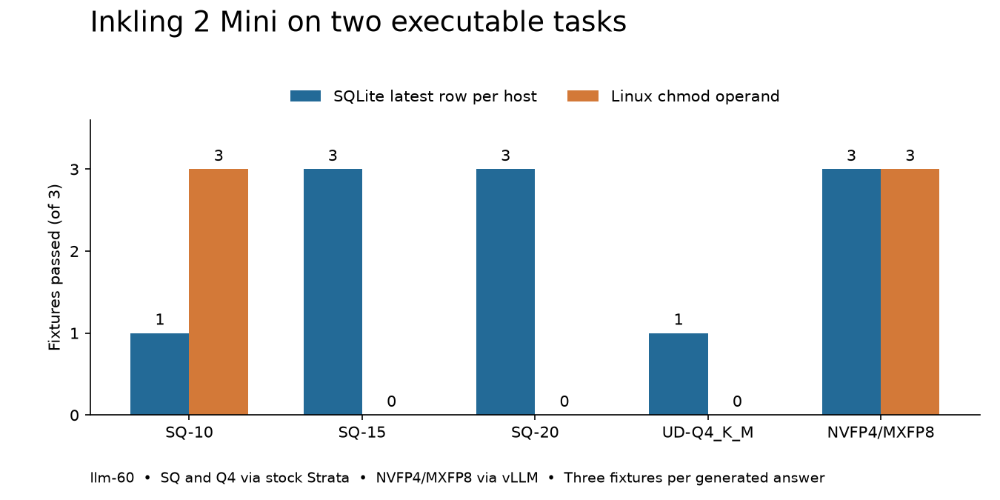

# Inkling 2 Mini qualification

Results cover the RTX PRO 6000 Blackwell on llm-60 unless a row names both hosts. A pass applies to the profile and workload described in its row. The [benchmark charts](../../../README.md#measured-performance) include sample counts and timings.

| Goal | Status | Verified result and remaining work |
|---|---|---|
| Reproducible install | Partial | A clean public checkout built the pinned CUDA bridge and passed text and vision checkpoint tests in a new virtual environment. Fresh-machine provisioning of CUDA and model assets is open. |
| Text serving | Pass for greedy single requests | PCC HTTP reproduced output tokens and checkpoint hashes after restart with zero saved-prefix replay. |
| cuBLAS workspace checkpoint isolation | Pass for SQ-10 token HTTP on llm-60 | Three server processes used one RAM-backed store. A checkpoint created with `:4096:8` returned HTTP 409 on generation under `:16:8`. Restoring `:4096:8` allowed the original branch revision to generate the same five tokens and payload SHA-256 with five native forward steps. |
| Vision serving | Pass for the prepared image path | Red and blue uploads produced distinct answers. Restored image frontiers and one-token continuations matched all 200,058 logits. On two 224×224 images with identical red/blue pixel counts and reversed halves, the prepared-image HTTP route correctly identified the left color in both. A fresh process reproduced both token streams and checkpoint payload hashes with zero prompt replay. The combined four-image regression later matched all answers and tokens after restart, but the left-blue case produced a different checkpoint payload hash. Only three of four payloads matched in that run. Reading native state first and frontier logits last, 198,966 of 200,058 left-blue logits differed bitwise (maximum absolute difference 0.001202), with the same argmax. The native payload differed in 75,506 ShortConv bytes, 490 key bytes and 343 value bytes. Eight identical continuation inputs gave the same eight argmax IDs but different logit rows. Reimporting the original payload also gave different rows on all eight steps, so the between-checkpoint difference alone cannot explain the continuation variance. [Continuation control](vision-spatial-continuation.csv). [Payload comparison](vision-spatial-restart-diff.csv) and [per-visit differences](vision-spatial-restart-visits.csv). With STRATA_INK_EXACT=1 and the same cuBLAS workspace, two independent write/restart trials passed all four images each. Every case also reproduced its payload hash across trials. The same four-image HTTP suite passed on the RTX 4090 in llm-49 under the forced-GPU settings. One restart reproduced all four token streams and payload hashes with zero prompt replay. Across the two hosts, all four generated token sequences matched, but every final checkpoint hash differed and only the left-red final frontier had the same argmax. The original prepared snapshots contained identical normalized image hashes, embedding bytes and text token IDs on both hosts for all four cases. All four prefill logit hashes already differed, while each prefill argmax agreed. [Prepared-input comparison](vision-cross-host-prefill.csv). [Cross-host results](vision-cross-host.csv). The auto-selected CPU cold-expert profile on llm-60 retains its recorded failure. [Forced GPU expert results](vision-forced-expert-restart.csv). |
| Request lifecycle | Pass for single-worker text | Disconnecting a streaming request preserved its branch and allowed a registered second request to finish identically to its control. Invalid lengths and stale revisions preserved the branch. On r730, all three disconnect trials on each of the two-P4 and three-P4 SQ-10 workers preserved the cancelled branch and reproduced the control tokens and checkpoint hash on the queued branch. |
| State exactness and isolation | Pass for pinned FP16 KV | RAM and fresh-process restore matched full logits before and after continuation. Sibling writes preserved the parent. Invalid identities and corrupt payloads were rejected. |
| Physical prefix reuse | Partial | Three 128K sibling lookups reused a device-resident parent with zero imported checkpoint bytes. Each live child still exports a full checkpoint. Offline parent-relative deltas reconstructed all three exactly. Live incremental child export and multi-branch memory scaling remain open. |
| AdamW output-head LoRA | Pass for rank 4 | Training CLI resumes matched uninterrupted losses, serving bytes and step-four optimizer state on the two-example fixture. |
| Factorwise Muon output-head LoRA | Pass for rank 4 | The same fresh-process and chained-resume checks passed. The second eight-step station round gained six answers and lost six. |
| Adapter serving and cache identity | Pass for tested head adapters | Both exported adapters launched over HTTP and restored after restart. Backend checks rejected cross-adapter reuse and recovered the exact base frontier when disabled. |
| SQ-10 and SQ-15 output-head LoRA | Training and native adapter serving passed on llm-60 | AdamW and factorwise Muon each reproduced the complete third optimizer step and exported adapter bytes after a fresh-process resume. The two adapted frontiers differed on each pack, cross-adapter checkpoint restores failed, and disabling the adapter recovered the full base frontier. An SQ-20 adapter was rejected on SQ-10. The SQ-10 Muon adapter also reproduced five generated tokens and the checkpoint hash over HTTP after a fresh server restart on one Tesla P4, forwarding five tokens. The loss measurements use two synthetic training examples. [Training receipts and frontier hashes](sq-head-lora.csv) |
| Transformer-layer LoRA and QLoRA | Component and vLLM reference tests passed | Rank-4 AdamW and factorwise Muon reproduced the third update and optimizer state after restart on a locally quantized 4-bit layer-0 query projection. Muon’s exported factors reproduced all 58,368 calibration outputs. Serving that adapter on the official mixed-precision model in vLLM changed eight first-token distributions. On eight complete answers, it lost one Linux answer and gained none. Disabling it restored every original answer. End-to-end training through the backbone, native Cached serving and internal-adapter cache isolation remain open. [Answer transitions](internal-lora-retention.csv) |
| Training on the latest misses | Completed one SQ-20 rank-4 AdamW pilot | Eight steps on three corrections took the base from 51/54 to 14/54. Subsequent updates used all misses from the previous round. Steps 11 and 16 reached 53/54. The final evaluation brought the ledger to 93,362,144 tokens, with 12 cases never used for gradients. Repeated evaluation makes this a development score. [Scores, gains and losses by step](failure-only-rounds.csv) |
| Fixed-rank rounds and retention | Partial | A fresh rank-4 residual combined with its rank-4 parent. Compressing the rank-8 sum to rank 4 lost one correct answer. Both optimizers reproduced the compressed export after a process restart and trained another round using it as the parent. On SQ-10, both optimizers also reproduced the second-round rank-4 compressed export and complete third optimizer step after restart. On two executable tasks, a second Muon round lost the base’s file-mode answer at combined rank 8 and remained wrong after compression to rank 4. AdamW retained it at both ranks. No profile fixed the SQL miss. [Per-task retention](sq10-round-retention.csv). Broader independent skill evaluation remains open. |
| Gain and regression tracking | Pass for the station evaluation | Per-question records preserve corrections and prior successes and identify gains and losses at every round. Failure-only practice reached 53/54 on the repeated register. On a fresh register the step-11 candidate scored 21/24 and the base scored 22/24. The base remains the default. |
| SQ-10 and SQ-15 vision restart | Passed on llm-60 | Each pack answered four color and spatial questions correctly. A fresh process reproduced the checkpoint hash and generated tokens in every case. One restart per pack. [Case results](vision-pack-restarts.csv) |
| Coding and Linux quantization pilot | Measured on llm-60 | With every expert resident, stock Strata answered eight short questions using each pack. SQ-10 got seven underlying answers right, SQ-15 and SQ-20 six each, and Unsloth UD-Q4_K_M five. Greedy decoding, reasoning off, one attempt per question. Task execution and full-repository repair remain outside this pilot. [Domain scores](quant-pilot.csv) |
| Resident continuation with explicit exactness settings | Repeat pass on llm-60 | On the 737-token Linux prompt, current SQ-20 with 133,120-position capacity, a 1,024 MiB GPU expert budget, GPU execution of cold experts and a fixed cuBLAS workspace repeated one checkpoint payload hash across five one-token probes. Three complete 147-token answers also repeated one payload hash and each got 13/18 counts right. Every request used one resident-parent restore and zero checkpoint import bytes. A second fresh process with a new RAM store regenerated the prompt and reproduced all 147 tokens and the complete payload hash across three more requests. [Six-request restart comparison](linux-rollup-exact-restart.csv). |
| Matched SQ packs on Linux exit counts | Measured on llm-60 | With a 1 GiB GPU expert budget and GPU execution for cold experts, SQ-10 counted 16/18 services correctly, SQ-15 counted 15/18 and SQ-20 counted 13/18. Each returned all 18 keys and repeated its payload hash in three trials on the same 97-record prompt. [Per-request results](linux-rollup-sq-packs.csv). A stock Strata UD-Q4_K_M reference counted 14/18 using 147 completion tokens in each of three requests. Under the same stock Strata settings SQ-10 counted 15/18 with 202 completion tokens. Stock SQ-15 counted 14/18 and stock SQ-20 counted 15/18. All four stock packs reported 738 cached prompt tokens on both repeats. [Stock pack comparison](linux-rollup-stock-packs.csv). |
| Linux exit-count summary | Three fresh branches per SQ-20 endpoint on llm-60 | For the same 97 records, the text endpoint (18061) counted 14/18 services correctly, the long-context endpoint (18069) counted 15/18, and the vision-enabled endpoint (18062) counted 11/18 using a text-only prepared chat. Every endpoint repeated its own 147-token sequence in all three requests. Each missed at least one count. On the long-context endpoint, three hash-verified checkpoints had the same input identity and consumed length (886), yet each pair differed in at least 200,057 of 200,058 saved logits. All selected token 200006 next. [Saved frontier comparison](linux-rollup-frontier.csv). Five one-token requests each reused the resident parent with zero imported bytes and three forward tokens, yielding three distinct saved logit rows. The service loaded SQ-20 with 1,472 GPU experts and 1,600 host experts, selected CPU evaluation for cold experts, and had no explicit cuBLAS workspace setting. Its native bridge SHA-256 was `c20fbc1b3920e39ba71c13140955b05e7e857a173a42be64e68760d7256a65a7`. These measurements apply to that build and placement. [Resident continuation counters](linux-rollup-resident-continuation.csv). [Per-request results](linux-rollup-repeats.csv) |
| Executable SQL and Linux tasks | SQ-20 comparison on llm-60 | Three requests per task and engine gave repeatable answers. Cached passed the file permissions task and stock HTTP passed the SQL task. In a separate native score probe with a 9 GiB GPU expert budget and GPU evaluation of cold experts, the top two SQL tokens reversed order relative to the verified Cached checkpoint after 20 common output tokens. Both picked the same permissions token after 11 common tokens. Adding a native checkpoint boundary immediately before the assistant opener changed the SQL winner and reproduced all 51 Cached SQL tokens and all 13 permissions tokens. The top scores still differ from Cached. Live stock HTTP logits remain open. [Frontier scores](sq20-frontier-comparison.csv) |
| Official mixed-precision reference | Measured on llm-60 | The same eight questions ran on the official NVFP4/MXFP8 checkpoint (revision c9d0283) with vLLM b9fc915ee, greedy decoding and effort zero. Native chat yielded zero visible answers at 64 output tokens and seven exact answers at 512. With Strata’s visible-answer opener and a 64-token limit, all eight answers were visible and four matched exactly. In the executable pilot, native vLLM chat returned a correct SQLite latest-per-host query (381 completion tokens) and an exact symbolic chmod operand (316). Both passed three fixtures. There was one greedy attempt per task at a 512-token limit. The Q4 Strata executable run used 213 host experts. [Executable scores by pack](executable-quant-pilot.csv). These measurements include differences in serving engines and prompt handling. [Reference scores](official-quant-pilot.csv) |
| Stock Strata comparison | Measured for single cold requests | Matched 64K and 128K transcription runs cover generation speed, complete throughput, TTFT and GPU memory. Stock was faster end to end. Repeated long-context tail latency and shared-parent crossover remain open. |
| DSpark | Experimental | Acceptance, speed, VRAM and restart continuation were measured for greedy unadapted text. A native linear-proposal test forced rejection after retaining 1, 4 or 7 positions. All four continuation rows matched the sequential reference in each of 12 cases. Verifier-only timing and forced rejection on the production tree path remain open. [Forced rollback results](dspark-forced-rollback.csv) |
| DFlash2 | Offline multi-block proposals on llm-60 | Pinned the [Inco AI checkpoint](https://huggingface.co/incoai/Inkling-2-Mini-DFlash2/tree/4f9088ea66c21f2b99ed657d1941c306b03e84d2). Its 989,975,616-byte weights file has SHA-256 `217980ab00d116693fa5946df7bbfd967caf5fac1f529afd541fbd470ddb54ee`. The config requests target hidden states at indices 5, 23, 41 and 48. The BF16 fusion projection has shape 2,304 × 9,216. The checkpoint proposes eight positions with 16 candidates per position. An offline probe used live SQ-10 capture buffers via host RAM and the official target embedding and output weights. Across five first blocks, learned embedding RMS normalization increased the sum of greedy matching prefixes from 0/35 to 19/35 tokens. One first-token rejection recovered two sequential full-logit rows after parent restore. Rewinding to the pre-verification position and replaying accepted tokens one at a time matched four subsequent full-logit rows on four original proposals and at every acceptance depth from zero through seven on a repeated-text prompt. Direct retention of the batched prefix failed the full-logit check. A four-block offline walk per prompt matched 17/28 Python, 19/28 Linux and 9/28 JSON proposal positions before the first mismatch in each block. Each block prefills the extended prefix from scratch after advancing by one anchor and the matched tokens. A separate SQ-10 target decoded 40 greedy tokens per prompt with one persistent KV slot and captured four hidden layers at every step. Offline proposals against those traces matched 45/84 again, but the first two Python blocks changed from 2 and 1 matches to 3 and 0. This comparison also changes the capture executable and enables decode-step taps. On the Python prompt, an identical-executable control repeated in a fresh process with decode taps disabled diverged at token four and differed on all 41 full-logit rows, including prefill. Enabling decode taps preserved all 40 greedy tokens relative to the first control but also differed on every row. This hybrid SQ-10 profile has no demonstrated fresh-process full-logit reproducibility. [Tap capture and repeat control](dflash2-tap-parity.csv). With all 3,072 experts resident, three fresh processes agreed on all 40 greedy tokens. Two had identical 41-row logit traces with decode capture toggled. The third differed from both on every row, starting at prefill. [Resident repeat control](dflash2-resident-parity.csv). A fixed-token repeat on prefixes of the same Python prompt produced one distinct full trace in three processes at each of 12, 16, 17 and 20 input tokens. At 23 tokens, all three processes produced different prefill logits but the same 40 output tokens. [Fixed-input length comparison](sq10-resident-prefill-repeats.csv). Keeping those same 23 IDs fixed, a 16+7 prefill gave one bit-identical trace in three processes and the same 40 output tokens as single-call prefill. Token-at-a-time prefill also repeated exactly but yielded different tokens. Single-call prefill produced two distinct traces in three contemporaneous controls. [Fixed-input chunking hashes](sq10-fixed-input-chunking.csv). With a single 23-token prefill, eight fresh processes using CUBLAS_WORKSPACE_CONFIG=:4096:8 produced one full-logit trace, while eight controls produced two. All 16 emitted the same 40 tokens. Coverage is one prompt and one fully resident SQ-10 profile. [Workspace trial hashes](sq10-cublas-workspace.csv). On the same 23 tokens with 1,577 host experts, the fixed workspace still yielded three different prefill rows in three processes. A 3,072-token synthetic log prompt repeated bit for bit within each of four combinations of placement and workspace (three processes each). [Extended workspace results](sq10-workspace-extended.csv). On the 23-token hybrid reproducer, both adaptive tiering and its fallback placement yielded four distinct prefill rows and two output sequences across four processes each with fixed cuBLAS workspace. Disabling adaptive tiering changed the loader allocation to 1,435 GPU experts and 59 promotion slots. [Hybrid tier trials](sq10-hybrid-tier-repeats.csv). A live two-process prototype connected the PyTorch drafter to a persistent hybrid SQ-10 target through host RAM. Over eight blocks per prompt, serial greedy verification accepted 91/168 proposals and committed 115 tokens including anchors. Decode-loop rates were 18.16 tokens/s on Python, 30.38 on Linux and 23.06 on JSON, one run each. Timing excludes startup and prefill. The prototype rebuilds drafter context, transfers output weights per block and verifies one token per target call. On a 3,072-token synthetic administration log with 259 committed tokens, retaining the target hidden states on the GPU and transferring only new rows cut tap reads from 3.89 GB to 122.50 MB and raised live decode from 42.27 to 55.95 tokens/s. Both configurations kept the output head resident and used serial verification, one run each. [Longer live trial](dflash2-3072-tap-transfer.csv). On a matched rerun, plain SQ-10 generated all 259 IDs identically at 87.44 tokens/s versus 56.18 for live DFlash2 with serial verification. [Plain greedy control](dflash2-3072-greedy-control.csv). A live batched verifier retained 31 fully accepted blocks and rewound the other two for serial verification. It reproduced all 259 control tokens at 75.65 tokens/s versus 87.49 plain on this prompt. Full-logit parity failed in an instrumented rerun. The prefill row matched exactly and both modes emitted the same 256 tokens, but each of the 256 subsequent rows differed. All 257 argmax IDs matched. [Per-token logit differences](dflash2-batch-logits.csv). Rewinding every linear tree verification to its starting position and consuming accepted tokens serially reproduced all 260 full-logit rows and all 259 emitted IDs against a fresh plain control across 33 live blocks on the same prompt. [Live replay parity](dflash2-live-replay-parity.csv). After the first replayed block at position 3,080, a fresh target process imported the 272,531,456-byte portable state and consumed the separately saved greedy anchor. All 32 subsequent full-logit rows matched the uninterrupted run without prompt prefill. This covers target-only restart through RAM-backed files. A fresh target and drafter then resumed from position 3,080 using the portable target image, next-token metadata and 113,541,120 bytes of saved target hidden states. The next 11 proposal paths, accepted lengths and anchor pairs matched the uninterrupted run, as did all 83 full-logit continuation rows. This prototype used RAM-backed files. On the same 3,072-token log and 259-token output, native fused DSpark achieved 148.45 and 147.92 tokens/s against 87.47 plain in both trials. Both used 1,495 GPU experts and 1,577 host experts. All output IDs matched the batched DFlash2 trial (75.65 tokens/s). A separate hybrid DSpark control had identical prefill logits and all 259 emitted IDs, followed by eight identical teacher-forced continuation inputs using ordinary target steps. All eight continuation rows differed from plain decoding and three had different argmax IDs. [Continuation parity](dspark-continuation-parity.csv). This measures native decode. Cached HTTP integration for DFlash2 remains open. [DSpark comparison](dspark-hybrid-control.csv). [Both-process restart result](dflash2-both-restart.csv). [Target restart result](dflash2-target-restart.csv). [Batched control](dflash2-batch-control.csv). [Live loop results](dflash2-live-loop.csv). [Continuous-target comparison](dflash2-continuous-target.csv). [Per-block results](dflash2-offline-walk.csv). [Rewind depth results](dflash2-rewind-depths.csv). [First-block comparison](dflash2-first-block.csv) |
| Bundled MTP head | Identified as the DSpark drafter | The official three-layer BF16 head in [mtp.safetensors](https://huggingface.co/thinkingmachines/Inkling-2-Mini/tree/c9d028302cd0f035fdf8e7e91f089a4ce94d2195) is 635,801,416 bytes, SHA-256 `7c3b651317f01f73bcf4e1dceba66ef8b7e1a1eac6bc171e882e690a4b10a1d2`. [vLLM’s DSpark loader](https://github.com/vllm-project/vllm/blob/b9fc915ee/vllm/models/inkling2/nvidia/dspark.py) selects that file. Strata also identifies it as the DSpark head available in SQ packs. The DSpark measurements above cover the bundled drafting mode. |
| Portable checkpoint preparation | Fresh-process HTTP restore passed on llm-60 | With SQ-20 and a 1 GiB GPU expert budget, the text answer reproduced all three tokens and its state hash after restart. All four color and spatial image answers also reproduced their tokens and state hashes with zero saved image or text replay. Each pair of processes used a shared temporary checkpoint store on tmpfs. |
| Oversized generation recovery | Passed on the live llm-60 SQ-20 text service | Requesting 8,208 output tokens on the 8,192-position profile returned HTTP 409. A new operation requesting 16 tokens on the same branch at the original revision succeeded, produced the exact requested word and advanced the revision from 1 to 2. |
| Single-request speed on two GPU models | Rough qualification passed | Across 16 greedy transcription runs at 3K and 6K input and 1,024 output tokens, both GPUs fit SQ-20 entirely in VRAM and returned identical token sequences for each matched prompt. With DSpark at 6K, the RTX 4090 on llm-49 averaged 238 generation and 134 end-to-end output tok/s. The RTX PRO 6000 on llm-60 averaged 287 and 170 respectively. [Per-trial timings](gpu-comparison.csv) |
| Host RAM for three independent P4 streams | Measured during SQ-10 prefill | With a 768 MiB GPU expert budget per process, Linux reported 24.64 GiB total proportional set size across three workers. Of that footprint, 24.34 GiB was private dirty memory. These process-wide readings exclude the separate tmpfs model file and do not identify individual tensors. [Per-worker memory sample](p4-prefill-host-memory.csv) |
| Immutable checkpoint digest reuse | Host microbenchmark on r730 | For a synthetic 2,302,705,664-byte RAM payload and 200,058 logits, recreating the owner and preparing the manifest took 6.07–6.12 seconds. Reusing the certified owner took 6.7–6.8 ms with identical envelope bytes. Three trials per path, after the original digest was computed. This isolates host preparation. [Trial timings](p4-owner-preparation.csv) |
| Long visible HTTP answer on one P4 | Passed twice on r730 | Two independent branches reused one 65,035-token SQ-10 register and listed all 40 requested labels in exact order. The 159 visible tokens took 24.33–25.82 seconds during generation and 69.03–72.03 seconds per complete warm request. Cold parent load took 1,079.44 seconds. Both requests reported one resident-parent restore and zero checkpoint-import bytes. [Timing and counters](p4-65k-visible-http.csv) · [Warm request timing chart](p4-65k-warm-timing.png) |
| Simultaneous decode after three real 64K prompts | Measured on r730 | Each independent SQ-10 worker read 65,504 tokens, waited at a barrier and ran 32 greedy decode steps. Across one trial, 96 steps in 5.823 seconds yielded 16.49 steps/s aggregate, with 97.5% three-way overlap. Each card matched its staggered token reference and returned the correct visible answer. [Per-card timings](p4-synchronized-64k.csv) · [Decode chart](p4-synchronized-64k.png) |
| Three independent 64K P4 contexts | Native capacity and final decode passed | Three SQ-10 processes on the r730 each loaded a synthetic 65,535-token state into FP16 GPU KV, then all crossed a barrier before decoding the final position. Each returned 200,058 finite logits. Free VRAM was 2,098, 2,200 and 2,200 MiB. All experts used host RAM. All three also read a real 65,504-token register and answered the final question correctly. At both 768 and 1,024 MiB of GPU expert budget, each emitted the visible answer `23` as one token followed by `<|end_message|>`. The 32-step native timing includes 30 further steps after the answer ended. It measures decode work at that context length. Visible HTTP response throughput requires a separate measurement. SQ-10 PCC HTTP also reproduced a short chat’s tokens and checkpoint payload after a process restart on a P4 with the exact GPU expert path. On one P4, a fresh HTTP process restored a 65K parent, reproduced the first lookup’s tokens, and answered a different question with zero further checkpoint import. [Shared-document HTTP results](p4-shared-document.csv) [Register results](p4-register.csv) [Per-card measurements](p4-capacity.csv). With a 1 GiB expert budget per card, three simultaneous SQ-10 workers each decoded the final 32 positions of a synthetic 64K state at 6.29–6.49 tok/s. The automatic probe selected CPU computation for cold experts on every card. [Expert placement and free VRAM](p4-64k-expert-budget.csv) |
| Parallel serving and GPU topology | Partial | Independent native slots were benchmarked, and queued PCC requests passed cancellation isolation. A single expert-parallel worker spanning two P4s reproduced a short HTTP answer and checkpoint hash after a process restart. On r730, an experimental [layer-split transfer patch](../../../experimental/branching_context/native/inkling/layer-split-checkpoint.patch) exported 104,497,152 bytes after 512 synthetic tokens. A fresh three-P4 native process restored the state and matched four continuation rows bit for bit (200,058 logits per row). Apply this patch after the portable-state and DSpark patches. A second fresh-process native test at 2,049 tokens restored 238,747,648 bytes after sliding-window wrap and matched four further full-logit rows. The repository regression at 4,097 tokens preserved the parent after a sibling write, rejected truncated input and recovered the full 200,058-logit continuation after restart. Three-card Cached HTTP also restored a short chat after a server restart, returning the same four tokens and checkpoint hash while forwarding only six tokens (two opener tokens and four generated). A fresh three-card worker restored a real 65,000-token BranchWrite document with one 2.30 GB import. A different lookup reused the resident parent with zero import. Both gave the expected labels. [Single- and three-card timings](p4-shared-document-topology.csv). In one abrupt-stop trial, the test killed its own server after the active request streamed a token and a second request registered as queued. After restart both operation statuses were absent, both branch heads were unchanged, and resubmitting the same operation IDs reproduced the uninterrupted control’s 96 token IDs and checkpoint hash on both branches. Neither request resumed automatically. Concurrent decoding on a shared PCC parent and repeated restart under sustained load remain open. |
| BranchWrite integration | Partial | Separate branches asked questions of a shared 128K register and receipt recovery was exercised. Two guided attempts independently fixed a real launcher bug in scoped workspaces. A separate client resumed after the edit at a step-budget boundary and completed verification. Whole-checkout registration and recovery during an interrupted tool write remain open. |

[Checkpoint regression](../../../tools/test_inkling_pcc.py) · [Vision regression](../../../tools/test_inkling_pcc_vision.py) · [Cancellation isolation](../../../tools/test_inkling_cancel_isolation.py) · [Trainer restart](../../../tools/test_inkling_training_restart.py) · [Adapter isolation](../../../tools/test_inkling_head_lora.py)
